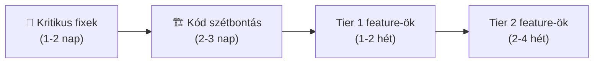

# 🔍 Szamlazo-App — Teljes Kód Audit & SaaS Roadmap

## Összefoglaló

A projekt egy **magyar nyelvű AI-alapú számlafeldolgozó SaaS**, ami Gemini Vision-nel fotóból kinyeri a számlaadatokat, Számlázz.hu-val kiállít, Stripe-pal monetizál, és MinIO-ban tárolja a képeket. A kód egy Hono backend + Astro statikus frontend, Docker-ben deployolva Coolify-ra.

A jelen állapot: **működő MVP, de monolitikus felépítés**. Az alábbi elemzés 3 fő témát fed le:

1. 🏗️ Kódminőség és szegregálási javaslatok
2. 🐛 Hibák, biztonsági kockázatok, technikai adósságok
3. 💡 SaaS feature roadmap (az IDEAS.md-re is építve)

---

## 1. 🏗️ Architektúra és Szegregálás

### A) A backend `index.ts` — a fő probléma

> [!CAUTION]
> [index.ts](file:///d:/github/szamlazo-app/backend/src/index.ts) **782 sor**, és tartalmazza a teljes üzleti logikát: Zod séma, kép feldolgozás, Gemini API hívás, SSE streaming, szöveg-feldolgozás, CRUD, export logika — mind egyetlen fájlban.

**Javasolt szétbontás:**

```
backend/src/
├── index.ts              # ~30 sor — csak app init + router mount
├── routes/
│   ├── invoices.ts       # GET /api/invoices, DELETE, PATCH
│   ├── parse.ts          # POST /api/parse-batch-stream, /api/invoices/parse-text
│   └── export.ts         # GET /api/invoices/export/csv, /api/invoices/export/rlb
├── services/
│   ├── gemini.ts         # Gemini API hívás izolálva (processSingleInvoice)
│   └── export-formatter.ts  # CSV és RLB formázó logika
├── schemas/
│   └── invoice.ts        # InvoiceDataSchema + InvoiceItemSchema (Zod)
├── middleware/
│   └── auth.ts           # getAuthUser middleware wrapper
├── auth.ts               # (már külön van, OK ✅)
├── billing.ts            # (már külön van, OK ✅)
├── settings.ts           # (már külön van, OK ✅)
├── szamlazz-integration.ts  # (már külön van, de problémás — lásd alább)
├── lib/
│   └── s3.ts             # (OK ✅)
└── db/
    ├── index.ts           # (OK ✅)
    └── schema.ts          # (OK ✅)
```

A **séma kiemelés** (`schemas/invoice.ts`) különösen fontos, mert jelenleg a [szamlazz-integration.ts](file:///d:/github/szamlazo-app/backend/src/szamlazz-integration.ts#L6) **visszaimportálja az `InvoiceDataSchema`-t az `index.ts`-ből**, ami cirkuláris dependency kockázatot jelent.

---

### B) A frontend `index.astro` — a másik óriás

> [!CAUTION]
> [index.astro](file:///d:/github/szamlazo-app/frontend/src/pages/index.astro) **~3000 sor** (118 KB!), amiből ~1900 sor inline `<script>` JavaScript. Ez egyetlen fájlban van: landing page, login/register form, dashboard, modálok, kártya rendszer, export, SSE kezelés, Stripe checkout, beállítások — **minden.**

**Javasolt szétbontás (Astro komponensek):**

```
frontend/src/
├── pages/
│   └── index.astro          # Csak layout shell (~100 sor)
├── components/
│   ├── LandingHero.astro    # Marketing szekció
│   ├── AuthForms.astro      # Login/Register/ForgotPw/ResetPw
│   ├── Dashboard.astro      # Fő dashboard konténer
│   ├── InvoiceCard.astro    # Egyetlen számla kártya
│   ├── InvoiceEditModal.astro  # Szerkesztő modál
│   ├── UploadZone.astro     # Drag & drop feltöltő
│   ├── ExportButtons.astro  # CSV + RLB gombok
│   ├── SettingsModal.astro  # API kulcs beállítások
│   ├── BillingModal.astro   # Kredit csomagok + Stripe
│   └── ProcessingLog.astro  # SSE feldolgozási napló
├── scripts/
│   ├── auth.ts              # Token kezelés, login/logout
│   ├── api.ts               # fetch wrapper (API_BASE, auth header)
│   ├── invoices.ts          # Számla CRUD, renderResultsCards()
│   ├── upload.ts            # Fájl/URL feldolgozás, SSE
│   └── export.ts            # CSV + RLB letöltés
└── styles/
    └── global.css
```

> [!TIP]
> Ha Astro-ban maradsz (statikus), az inline `<script>` helyett `<script>` tag-ekbe `import`-olt TypeScript fájlok ajánlottak. Ha dinamikusra vált, React/Svelte island-ekre bonthatóvá válik.

---

### C) A `shared/` mappa

Jó ötlet, de jelenleg nincs NPM workspace beállítva. A `../../shared/types.js` relatív import törékeny.

**Javaslat:** Legyen `shared` egy workspace package:

```jsonc
// Gyökér package.json
{
  "workspaces": ["shared", "backend", "frontend"]
}
```

Ezután: `import { InvoiceData } from '@szamlazo/shared'`

---

## 2. 🐛 Hibák és Technikai Adósság

### 🔴 Kritikus

| # | Probléma | Fájl | Mit okoz |
|---|----------|------|----------|
| 1 | **JWT secret hardkódolva** | [auth.ts#L10](file:///d:/github/szamlazo-app/backend/src/auth.ts#L10) | `'szamla-ai-secret-key-change-in-prod-2026'` — Ha az env var hiányzik prodban, ez a default fut, és bárki generálhat valid tokent. |
| 2 | **S3 secret hardkódolva** | [s3.ts#L12](file:///d:/github/szamlazo-app/backend/src/lib/s3.ts#L12) | `'5:?EgI9HX291Ie,5TbH'` default secret — ha prodban nincs env var, publikusan hozzáférhető. |
| 3 | **szamlazz-integration.ts mojibake** | [szamlazz-integration.ts](file:///d:/github/szamlazo-app/backend/src/szamlazz-integration.ts#L18) | Az egész fájl tele van `á`, `é`, `Å'` kódolási hibákkal. Feltehetően valamelyik edit ANSI-ként mentette. **Az egész fájlt UTF-8-ként újra kell menteni!** |
| 4 | **Dupla kredit jóváírás** | [billing.ts](file:///d:/github/szamlazo-app/backend/src/billing.ts#L85-L125) | A `verify-session` **és** a `webhook` is jóváír krediteket. Ha mindkettő lefut (ami mindig megtörténik), dupla krediteket kap a felhasználó. Kell egy `payment_processed` flag vagy idempotency key. |
| 5 | **DB init elcsúszva** | [db/index.ts](file:///d:/github/szamlazo-app/backend/src/db/index.ts#L46-L60) | A `CREATE TABLE` nem tartalmazza az `is_deleted` és `reset_token`/`reset_token_expiry` oszlopokat, de a schema igen. `ALTER TABLE ADD COLUMN IF NOT EXISTS` nincs mindegyikre. |

### 🟡 Fontos

| # | Probléma | Fájl |
|---|----------|------|
| 6 | **Nincs rate limiting** | `index.ts` | Bárki spam-elheti az AI feldolgozást (Gemini API költség). |
| 7 | **Gemini prompt a kódban** | [index.ts#L128-L158](file:///d:/github/szamlazo-app/backend/src/index.ts#L128-L158) | A 30 soros prompt-string a kód közepén van, nem konfigurálható. |
| 8 | **Nincs JWT lejárat** | [auth.ts#L48](file:///d:/github/szamlazo-app/backend/src/auth.ts#L48) | A token soha nem jár le. Ha valakinek kikerül a tokenje, örökké használható. |
| 9 | **`catch (err: any)`** | Mindenhol | Nincs strukturált error handling. Prod hiba = nyers stack trace a kliensnek. |
| 10 | **Teszt lefedettség minimális** | [tests/](file:///d:/github/szamlazo-app/backend/tests) | Csak 2 tesztfájl, ~110 sor. Nincs teszt a billing-re, export-ra, Gemini feldolgozásra. |

### 🟢 Kisebb (de érdemes)

| # | Probléma |
|---|----------|
| 11 | A gyökérben maradt temp fájlok: `fix_js.js`, `fix_regex.js`, `script.js`, `test*.js` — `.gitignore`-ba vagy törlésre. |
| 12 | `Dockerfile.backend` CMD eltérés: `dist/backend/src/index.js` vs `dist/index.js` — ellenőrizni kell, melyik a helyes. |
| 13 | A `prompt` string konstans a fő kódban, nem konfigurálható fájlból. |
| 14 | Nincs pagination az `/api/invoices` végponton (hardkódolt `limit(50)`). |
| 15 | Az export végpontok nem szűrnek dátumtartományra (mindig az összes számlát adják). |

---

## 3. 💡 SaaS Feature Roadmap

Az IDEAS.md-ben lévő ötleteket figyelembe véve, üzleti prioritás szerinti sorrendben:

### 🏆 Tier 1 — "Fizetnek érte holnap" (alacsony effort, magas érték)

#### 1. Dátumszűrős export + többféle könyvelőprogram
- **Miért:** Minden könyvelő más programot használ (RLB, Kulcs-Soft, KBOSS, Novitax). Ha mindegyiknek van export-ja, minden könyvelő behúzza a cégét.
- **Effort:** Közepes (~2-3 nap/formátum). Az RLB minta már kész, a többi hasonló sémájú.
- **Monetizáció:** Pro tier funkció.

#### 2. Költségkategóriák + havi összesítő dashboard
- **Miért:** A "befotózta, kész" után a cégvezető látni akarja: "Mennyit költöttem rezsire vs. anyagra ebben a hónapban?"
- **Effort:** Közepes. Egy `category` mező hozzáadása + Gemini prompt bővítés automatikus kategorizálásra + egy egyszerű barchart a dashboardon.
- **Monetizáció:** Pro tier. A free tier csak a listát látja, a Pro a chartot is.

#### 3. Fizetési mód felismerés + állapotkezelés
- **Miért:** "Ezt a számlát kifizettük?" — A leggyakoribb kérdés. Ha a Gemini felismeri, hogy "átutalás" vagy "készpénz", és a felhasználó kézzel beállíthatja a "Fizetve" státuszt, az már egy mini-pénzügykezelő.
- **Effort:** Alacsony. Egy `paymentStatus` mező a schemában + egy gomb a kártyán.

---

### 🥈 Tier 2 — "Komoly versenyképesség" (közepes effort)

#### 4. [C] Csoportos munka és jogosultságok (KKV fókusz)
*Az IDEAS.md-ből.*
- **Miért:** Egy villanyszerelő cég 3 embere fotóz, a könyvelő meg nézi a végeredményt. Ha mindenki saját fiókba fotóz, szétesik az adat. Ha viszont van "cég" (organization), az alkalmazottak a céghez töltik fel, a főnök egyben látja, a könyvelő exportálja.
- **Effort:** Magas. Új `organizations` + `org_members` tábla, role-based access control, meghívó rendszer.
- **Monetizáció:** Business tier. A free egyedül van, a Pro 3 fős csapat, a Business korlátlan.

#### 5. [E] NAV Online Számla közvetlen lekérés
*Az IDEAS.md-ből.*
- **Miért:** A bejövő ÁFÁ-s számlák 80%-a már a NAV-ban van. Ha ezt automatikusan lehúzzuk, a felhasználónak csak a maradék 20%-ot (kisnyugta, külföldi) kell fotóznia.
- **Effort:** Magas. A NAV API technikailag komoly (XML aláírás, SHA-512 hash chain). De ha megvan, ez egy **game changer** a piacon.
- **Monetizáció:** Pro+ tier.

#### 6. "Villanyszerelő Józsi" — Hangalapú diktálás
*Az IDEAS.md-ből.*
- **Miért:** A célcsoport (kétkezi munkás) nem szeret gépelni. Ha bemondja, hogy "Kovács Kft-nek szereltem csaptelepet, 35 ezer plusz áfa", a Gemini ezt azonnal számlává alakítja.
- **Effort:** Közepes. A browser `MediaRecorder` API + Gemini audio → szöveg → function calling. Az AI rész nagyrészt megvan a `parse-text` végpontban, csak hangot kell előtte szöveggé alakítani.
- **Monetizáció:** Kredit-alapú, mint most.

---

### 🥉 Tier 3 — "Vízió" (magas effort, de nagy moat)

#### 7. Bejövő email fiók (`szamla@cegem.szamlazzjol.hu`)
- **Miért:** A Telekom, Vodafone, Google, Azure mind emailben küldi a PDF számlát. Ha van egy dedikált email cím, amit a felhasználó beállít "számlázási email"-nek ezeknél a szolgáltatóknál, a rendszer automatikusan lehúzza és feldolgozza a PDF-eket.
- **Effort:** Nagyon magas. Custom SMTP inbound (pl. Cloudflare Email Workers vagy Mailgun inbound), PDF parsing, auto-jóváhagyás.

#### 8. Okos Címtár (Partner Memória)
*Az IDEAS.md-ből.*
- **Miért:** "Kovács Kft" — kit érdekel az adószám? A rendszer emlékszik, és kitölti. A könyvelő nem fog hibás adószámot kapni.
- **Effort:** Közepes. Egy `partners` tábla `user_id`-vel, ami a korábbi számlákból automatikusan épül. A Gemini `parse-text` útvonalán belül fuzzy match-csel kiegészíthető.

#### 9. Többnyelvű felismerés + EU-s ÁFA
- **Miért:** Egy magyar cég kaphat német/osztrák/román számlát is. Ha a rendszer felismeri az EU-s reverse charge-ot vagy az intra-community szállítást, a könyvelő boldog.

---

## 4. Priorizált Akcióterv (Javasolt sorrend)



### Lépés 1: Kritikus fixek (1-2 nap)
- [ ] JWT + S3 secret fallback eltávolítása (ha nincs env var → crash, ne silent fallback)
- [ ] Billing dupla jóváírás javítás (idempotency key)
- [ ] `szamlazz-integration.ts` mojibake javítás (UTF-8 újramentés)
- [ ] JWT lejárat bevezetése (pl. 7 nap)
- [ ] DB init hiányzó `ALTER TABLE` parancsok kiegészítése
- [ ] Temp fájlok törlése a gyökérből

### Lépés 2: Kód szétbontás (2-3 nap)
- [ ] Backend `index.ts` → `routes/`, `services/`, `schemas/`
- [ ] Frontend `index.astro` → Astro komponensek + külső script fájlok
- [ ] `shared` → NPM workspace package

### Lépés 3: Tier 1 feature-ök (1-2 hét)
- [ ] Dátumszűrő az exportra
- [ ] Költségkategória mező + AI kategorizáció
- [ ] Fizetési állapot kezelés
- [ ] Kulcs-Soft export formátum (az RLB mellé)
