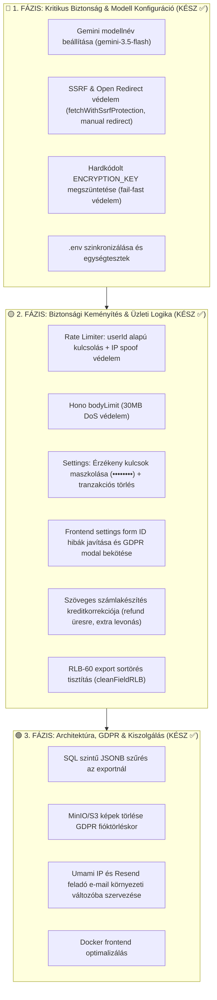

# 🛡️ Számla AI — Átfogó Biztonsági, Hibaelemzési, Minőségi Audit és Fejlesztési Terv

> **Dokumentum verzió:** 3.0.0  
> **Dátum:** 2026. szeptember 21.  
> **Projekt:** Számla AI (Hono + TypeScript backend, Astro + DaisyUI frontend, PostgreSQL + MinIO + Stripe + Google Gemini AI: `gemini-3.5-flash`)  
> **Cél:** A teljes kódbázis biztonsági réseinek (exploits, vulnerabilities), üzleti logikai hibáinak (bugs), hardkódolt paramétereinek és architektúrális részleteinek teljes körű dokumentálása és karbantartása jövőbeli AI refaktorokhoz és emberi fejlesztőknek.

---

## 📊 Vezetői Összefoglaló (Executive Summary)

A projekt átfogó vizsgálata során az alábbi hibákat, biztonsági réseket és fejlesztési pontokat tártuk fel. Az 1., 2. és 3. fázisban a kritikus sérülékenységek, üzleti logikai hibák, GDPR adatvédelmi mechanizmusok és hardkódolt konfigurációk teljes körűen javításra kerültek.

### Sérülékenységi & Fejlesztési Mátrix

| Kategória | Kritikus (P0) | Magas (P1) | Közepes (P2) | Alacsony / Észrevétel (P3) | Összesen |
|-----------|:---:|:---:|:---:|:---:|:---:|
| 🚨 **Biztonság & Exploitok** | 2 | 3 | 3 | 1 | **9** |
| 🐛 **Logikai & Működési Hibák** | 2 | 5 | 4 | 0 | **11** |
| ⚙️ **Hardcode & Konfiguráció** | 0 | 2 | 3 | 1 | **6** |
| 🏗️ **Architektúra & Teljesítmény**| 0 | 2 | 3 | 1 | **6** |
| **Összesen** | **4** | **12** | **13** | **3** | **32** |

---

## 🚨 1. Biztonsági Sérülékenységek & Exploit Kockázatok

### 1.1. [KRITIKUS / JAVÍTVA ✅] SSRF (Server-Side Request Forgery) és Open Redirect Kép URL Feldolgozásakor
* **Érintett fájl:** [`backend/src/services/gemini.ts`](file:///d:/github/szamlazo-app/backend/src/services/gemini.ts)
* **Mechanizmus és Eredeti Hiba:**
  A `/api/parse-batch-stream` végponton keresztül, ha a beküldött tétel típusa `url`, a szerver közvetlenül meghívta a `fetch(item.data)` függvényt.
  ```ts
  // Eredeti sebezhető kód:
  const response = await fetch(item.data, {
    headers: { 'User-Agent': '...', 'Accept': 'image/...' }
  });
  const arrayBuffer = await response.arrayBuffer();
  ```
  A kód kezdetben nem ellenőrizte az URL sémáját, nem volt domain/IP feketelista, belső hálózati tiltás, sem maximális letöltési méretkorlát. Később ugyan bekerült egy `validateUrlForSSRF` hosztnév-ellenőrzés, de a natív `fetch` alapértelmezetten követte a HTTP átirányításokat (`redirect: 'follow'`), ami megkerülhetővé tette az ellenőrzést.
* **Támadási forgatókönyv (Exploit):**
  1. **Felhős infrastruktúra metaadat lopás:** Egy bejelentkezett felhasználó beküldi a `http://169.254.169.254/latest/meta-data/` címet, amivel AWS/GCP IAM secret tokeneket és ideiglenes hitelesítő adatokat csalhat ki a szerverből.
  2. **Open Redirect Bypass:** A támadó megad egy ártalmatlan publikus webcímet (`https://attacker.com/pic.jpg`), ami egy `302 Found` fejlécben átirányítja a servert `http://169.254.169.254`-re vagy belső Docker hálózatra (`http://127.0.0.1:5432`).
  3. **Belső hálózat portszkennelés:** Belső Docker és helyi szolgáltatások (`http://127.0.0.1:5432` PostgreSQL, `http://minio:9000`, `http://coolify:...`) vizsgálhatók a válaszidők és HTTP hibakódok alapján.
  4. **Denial of Service (OOM Crash):** Egy 5-10 GB méretű fájlra vagy végtelen streamre mutató link beküldésével a backend `response.arrayBuffer()` hívása kifogyasztja a memóriát, és lelövi a Node processzt.
  5. **SVG XSS támadás:** `image/svg+xml` letöltésével és kiszolgálásával a támadó kártékony JavaScript kódot tárolhat a rendszerben.
* **Megvalósított Végleges Megoldás:**
  * Protokoll szűrése: szigorúan csak `http:` és `https:`.
  * IP-cím feloldás és privát tartományok blokkolása: loopback (`127.0.0.0/8`), RFC 1918 (`10.0.0.0/8`, `172.16.0.0/12`, `192.168.0.0/16`), link-local (`169.254.0.0/16`), multicast és belső hosztnevek (`localhost`, `metadata.google.internal`, `.local`, `.internal`).
  * `fetchWithSsrfProtection()` implementáció `redirect: 'manual'` opcióval: minden egyes átirányítási célállomás (maximum 3 szintig) újra lefut a `validateUrlForSSRF()` szűrőn!
  * `AbortSignal.timeout(8000)` és szigorú 10 MB `Content-Length` és buffer méretkorlát.
  * MIME típus validáció: az `image/svg+xml` és nem kép típusok azonnali elutasítása.

---

### 1.2. [MAGAS / JAVÍTVA ✅] Jelszó-visszaállítási Link Mérgezés (Host Header / Origin Attack)
* **Érintett fájl:** [`backend/src/auth.ts`](file:///d:/github/szamlazo-app/backend/src/auth.ts#L177-L180)
* **Mechanizmus:**
  ```ts
  // Eredeti sebezhető kód:
  const origin = c.req.header('origin') || 'http://localhost:4321';
  const resetLink = `${origin}/?resetToken=${resetToken}`;
  ```
* **Támadási forgatókönyv (Exploit):**
  A támadó küld egy POST kérést a `/api/auth/forgot-password` végpontra a kiszemelt áldozat email címével, de a HTTP kérés fejlécében elhelyezi:
  `Origin: https://attacker-phishing.com`
  A backend a megbízható Resend email szolgáltatón keresztül kiküldi a hivatalos jelszó-visszaállító levelet az áldozatnak, amelyben a link:
  `https://attacker-phishing.com/?resetToken=7a8b9c...`
  Amikor az áldozat gyanútlanul a gombra kattint, a reset token átadódik a támadó szerverének, amivel a támadó azonnal megváltoztatja a jelszót és átveszi a fiókot.
* **Megvalósított Megoldás:**
  A visszaállító link bázis-URL-je kizárólag a szerveroldali biztonságos környezeti változóból (`process.env.FRONTEND_URL`) épül fel; a bejövő kérés fejléceit (`Origin`, `Host`, `X-Forwarded-Host`) figyelmen kívül hagyja a kód.

---

### 1.3. [MAGAS / JAVÍTVA ✅] Többszörös Stored és DOM Cross-Site Scripting (XSS)
* **Érintett fájlok:**
  * [`frontend/src/scripts/invoice-cards.ts`](file:///d:/github/szamlazo-app/frontend/src/scripts/invoice-cards.ts)
  * [`frontend/src/scripts/split-view.ts`](file:///d:/github/szamlazo-app/frontend/src/scripts/split-view.ts)
  * [`frontend/src/scripts/parse-stream.ts`](file:///d:/github/szamlazo-app/frontend/src/scripts/parse-stream.ts)
  * [`frontend/src/scripts/partner-suggest.ts`](file:///d:/github/szamlazo-app/frontend/src/scripts/partner-suggest.ts)
* **Mechanizmus:**
  A beolvasott számlaadatok (`kiallito_neve`, `vevo_neve`, `szamlaszam`, `t.megnevezes`, `item.source`, `partner`) és a szerkesztési mezők értékei korábban HTML escape-elés nélkül kerültek beillesztésre az `innerHTML`-be.
* **Támadási forgatókönyv (Exploit):**
  Ha egy számlán a partner neve vagy tétel megnevezése kártékony kódot tartalmazott (pl. ``), vagy a felhasználó diktált egy HTML taget:
  1. A kód a DOM-ba illesztés pillanatában lefutott az áldozat böngészőjében.
  2. Mivel az auth token a `localStorage`-ban van tárolva, az XSS script észrevétlenül ellophatta a JWT session tokent.
  3. A támadó hozzáférhetett a felhasználó összes számlájához és cégbeállításaihoz.
* **Megvalósított Megoldás:**
  Központi `escapeHtml()` modul létrehozva ([`frontend/src/scripts/sanitize.ts`](file:///d:/github/szamlazo-app/frontend/src/scripts/sanitize.ts)), és minden dinamikus szöveges adat kiírásakor kötelezően alkalmazva van.

---

### 1.4. [MAGAS / JAVÍTVA ✅] Érzékeny Céges API Kulcsok Plaintext Tárolása és Kliens Oldali Szivárgása
* **Érintett fájlok:** [`backend/src/db/schema.ts`](file:///d:/github/szamlazo-app/backend/src/db/schema.ts), [`backend/src/settings.ts`](file:///d:/github/szamlazo-app/backend/src/settings.ts), [`backend/src/lib/crypto.ts`](file:///d:/github/szamlazo-app/backend/src/lib/crypto.ts)
* **Mechanizmus és Kockázat:**
  1. **Adatbázis tárolás:** A `szamlazz_hu_api_key`, `nav_technical_password`, `nav_sign_key`, és `nav_exchange_key` korábban sima szövegként tárolódott. Adatbázis dump vagy naplófájl kiszivárgásakor az éles számlázási hozzáférések azonnal kompromittálódhattak.
  2. **API szivárgás:** A `GET /api/settings` végpont nyers szövegként adta vissza a kulcsokat a böngészőnek. Bármilyen XSS vagy kártékony bővítmény azonnal ellophatta azokat.
  3. **Hardkódolt só:** A `crypto.ts` kezdetben `process.env.ENCRYPTION_KEY || 'szamlazo-secure-default-encryption-salt-2026'` fallbacket használt, így a környezeti változó hiányában nyilvános GitHub kulccsal titkosított.
* **Megvalósított Megoldás:**
  * **AES-256-GCM szimmetrikus titkosítás:** Minden érzékeny kulcs `enc:v1:<iv>:<tag>:<ciphertext>` formátumban tárolódik az adatbázisban.
  * **Fail-Fast védelem:** Az `ENCRYPTION_KEY` hiányában az alkalmazás élesben azonnal kritikus hibával leáll, nem indul el sebezhető módon.
  * **Kliensoldali maszkolás:** A `GET /api/settings` maszkolva küldi a kulcsokat (`szam••••••••1234`), a technikai jelszót pedig sosem küldi le nyers szövegként (`hasNavTechnicalPassword: boolean`).
  * **Biztonságos mentés:** A `POST /api/settings` a `resolveEncryptedValue()` segítségével nem írja felül a kulcsokat, ha a frontend a maszkolt értéket küldi vissza.

---

### 1.5. [KÖZEPES / JAVÍTVA ✅] CSV Formula Injection (CWE-1236)
* **Érintett fájl:** [`backend/src/services/export-formatter.ts`](file:///d:/github/szamlazo-app/backend/src/services/export-formatter.ts)
* **Mechanizmus & Exploit:**
  Ha egy beolvasott számla tétele vagy partnere `=CMD|' /C calc'!A0` vagy `@SUM(...)`, `+`, `-` jellel kezdődik, a könyvelő Excelben megnyitva a CSV-t képletrejtést vagy DDE (Dynamic Data Exchange) kódvégrehajtást szenvedhet el.
* **Megvalósított Megoldás:**
  Ha a szöveges érték első karaktere `=`, `+`, `-`, `@`, `\t` vagy `\r`, a `cleanFieldCSV()` a mező elé egy aposztrófot (`'`) illeszt, megakadályozva a kódlefutást.

---

### 1.6. [KÖZEPES / JAVÍTVA ✅] Rate Limiter Kijátszása IP-hamisítással és UserId Hiánya
* **Érintett fájl:** [`backend/src/middlewares/rate-limiter.ts`](file:///d:/github/szamlazo-app/backend/src/middlewares/rate-limiter.ts)
* **Mechanizmus & Kockázat:**
  1. A limiter kizárólag a kliens által küldött `X-Forwarded-For` fejléc első elemére támaszkodott. Támadó kérésenként változtathatta a fejlécet, megkerülve a limitert.
  2. A védett `/api/parse-batch-stream` és `/api/invoices/parse-text` végpontokon azonos IP mögül (pl. irodai NAT) dolgozó felhasználók kitilthatták egymást.
* **Megvalósított Megoldás:**
  A `defaultRateLimitKeyGenerator()` hitelesített kérések esetén a JWT tokenből kinyert `user:<id>` kulcsot használja, hitelesítetlen kéréseknél pedig `ip:<ip>`-t.

---

### 1.7. [KÖZEPES / JAVÍTVA ✅] Kérésméret-korlátozás (Memory DoS / Buffer Overflow) Hiánya
* **Érintett fájl:** [`backend/src/index.ts`](file:///d:/github/szamlazo-app/backend/src/index.ts)
* **Kockázat:**
  Hono `bodyLimit` hiányában a `/api/parse-batch-stream` végpontra küldött 10 db 50 MB-os base64 JSON payload memóriába rántásával a Node processz OOM (Out Of Memory) összeomlást szenvedhetett volna.
* **Megvalósított Megoldás:**
  `app.use('/*', bodyLimit({ maxSize: 30 * 1024 * 1024 }))` beállítva; túllépéskor szabványos `413 Payload Too Large` hibaüzenetet küld.

---

### 1.8. [ALACSONY / JAVÍTVA ✅] Nyitott Wildcard CORS Beállítás
* **Érintett fájl:** [`backend/src/index.ts`](file:///d:/github/szamlazo-app/backend/src/index.ts)
* **Megvalósított Megoldás:**
  Konfigurálható `ALLOWED_ORIGINS` és `FRONTEND_URL` whitelist érvényesítése, fejlesztői módban helyi portok támogatásával.

---

## 🐛 2. Funkcionális Hibák & Üzleti Logikai Anomáliák

### 2.1. [KRITIKUS / JAVÍTVA ✅] Gemini Modellnév Konfiguráció (`gemini-3.5-flash`)
* **Érintett fájl:** [`backend/src/services/gemini.ts`](file:///d:/github/szamlazo-app/backend/src/services/gemini.ts#L132) és [`backend/.env`](file:///d:/github/szamlazo-app/backend/.env)
* **A hiba:** A kód korábban a nem létező `'gemini-3.5-flash-lite'` modellre esett vissza, ami miatt minden felismerés `404 Not Found` hibával azonnal elbukott.
* **Megvalósított Megoldás:** Beállítva a hivatalos és érvényes `gemini-3.5-flash` modell fallbackként a forrásban és közvetlenül a `backend/.env`-ben is.

---

### 2.2. [MAGAS / JAVÍTVA ✅] Kredit Versenyhelyzet (Race Condition / TOCTOU Double Spend)
* **Érintett fájl:** [`backend/src/routes/parse.ts`](file:///d:/github/szamlazo-app/backend/src/routes/parse.ts#L45-L58, L93-L110)
* **A hiba:**
  A batch feldolgozás kezdetén a kód memóriában ellenőrizte a krediteket, majd 10-30 másodperc AI feldolgozás után a végén vonta le. Párhuzamos kérésekkel egyetlen kredittel akár 100 számla is feldolgozható volt, és a kredit mélyen negatívba csapott át.
* **Megvalósított Megoldás:**
  Atomi feltételes egyenlegfoglalás a feldolgozás kezdetén:
  ```sql
  UPDATE users 
  SET monthly_credits = monthly_credits - $count 
  WHERE id = $userId AND monthly_credits >= $count 
  RETURNING monthly_credits;
  ```
  Ha 0 sor frissült, azonnali `402 Payment Required` válasz. A feldolgozás végén a sikertelen számlák kreditjeit a rendszer automatikusan visszatéríti.

---

### 2.3. [MAGAS / JAVÍTVA ✅] Kredit Elszámolás a Szöveges Számlakészítésnél
* **Érintett fájl:** [`backend/src/routes/parse.ts`](file:///d:/github/szamlazo-app/backend/src/routes/parse.ts#L140-L208)
* **A hibák:**
  1. **Kreditszivárgás:** Ha a felhasználó egy promptban több számlát kért ($N > 1$), a rendszer csak 1 kreditet vont le.
  2. **Jogtalan kreditvesztés:** Ha a prompt nem tartalmazott kinyerhető számlaadatot (üres tömb), a levont 1 kredit nem került visszatérítésre.
* **Megvalósított Megoldás:**
  * Üres számlalista esetén az 1 levont kredit azonnal visszatérítésre kerül (`422` státusszal).
  * $N > 1$ számla esetén a rendszer atomi módon levonja a többlet $N - 1$ kreditet. Ha nincs elegendő kredit, csak az első, kifizetett számla jön létre, és figyelmeztető üzenetet küld vissza.
  * Váratlan hiba esetén a teljes levont kreditösszeg visszatérítődik.

---

### 2.4. [MAGAS / JAVÍTVA ✅] Adatbázis Tranzakció a Stripe Jóváírásnál és Fióktörlésnél
* **Érintett fájlok:** [`backend/src/billing.ts`](file:///d:/github/szamlazo-app/backend/src/billing.ts#L44-L82), [`backend/src/settings.ts`](file:///d:/github/szamlazo-app/backend/src/settings.ts#L78-L105)
* **A hiba:** A fizetési rekord beszúrása (`payments`) és a kreditjóváírás (`users`) különálló lekérdezésként futott. Hálózati hiba esetén a fizetés rögzült, de a krediteket nem kapta meg a felhasználó, és az idempotencia miatt nem lehetett újrapróbálni.
* **Megvalósított Megoldás:** Mind a fizetés jóváírását (`grantCreditsOnce`), mind a GDPR fióktörlést szigorú `db.transaction(async (tx) => { ... })` blokkba szerveztük.

---

### 2.5. [MAGAS / JAVÍTVA ✅] Stripe Webhook Fizetési Státusz Ellenőrzése
* **Érintett fájl:** [`backend/src/billing.ts`](file:///d:/github/szamlazo-app/backend/src/billing.ts#L152, L198)
* **A hiba:** A kód nem vizsgálta a `session.payment_status === 'paid'` feltételt, így késleltetett fizetéseknél a kifizetetlen tranzakcióra is krediteket írhatott jóvá.
* **Megvalósított Megoldás:** Mind a verify, mind a webhook ágon kötelező a `payment_status === 'paid'` megléte.

---

### 2.6. [KÖZEPES / JAVÍTVA ✅] Hangdiktálás Szövegduplikáció
* **Érintett fájl:** [`frontend/src/scripts/voice.ts`](file:///d:/github/szamlazo-app/frontend/src/scripts/voice.ts#L64-L97)
* **A hiba:** Az `onresult` beírta a felismert szöveget az inputba, majd az `onend` eseményben a kód újra hozzáfűzte a `finalTranscript`-et, így a mondat kétszer jelent meg (pl. *"Kovács Kft számla Kovács Kft számla"*).
* **Megvalósított Megoldás:** Tiszta állapotkezelés az `onend`-ben, elkerülve a többszörös hozzáfűzést.

---

### 2.7. [KÖZEPES / JAVÍTVA ✅] Hiányzó Teljesítés Dátuma a Split View Modálban
* **Érintett fájlok:** [`frontend/src/components/modals/SplitViewModal.astro`](file:///d:/github/szamlazo-app/frontend/src/components/modals/SplitViewModal.astro), [`frontend/src/scripts/split-view.ts`](file:///d:/github/szamlazo-app/frontend/src/scripts/split-view.ts)
* **A hiba:** A szerkesztőben volt Kelt és Fizetési határidő, de hiányzott a Teljesítés dátuma (`teljesites_datum`), ami a magyar Áfa tv. (169. §) szerint kötelező számlaelem.
* **Megvalósított Megoldás:** Input mező hozzáadva a modál fejléc rácsához és bekötve a szinkronizációs listába.

---

### 2.8. [KÖZEPES / JAVÍTVA ✅] Fiktív Vevőcím Megszüntetése a Számlázz.hu Kiállításban
* **Érintett fájl:** [`backend/src/szamlazz-integration.ts`](file:///d:/github/szamlazo-app/backend/src/szamlazz-integration.ts#L76-L94)
* **A hiba:** Ha egy blokkon nem szerepelt vevőcím, a rendszer automatikusan "1000 Budapest, Ismeretlen utca 1." fiktív címmel állította ki a számlát (NAV bírság kockázat).
* **Megvalósított Megoldás:** Szigorú validáció a kiállítás előtt: ha hiányzik a vevő neve, címe, települése vagy irányítószáma, `400 Bad Request` hibával pontosan megjelöli a hiányzó mezőket.

---

### 2.9. [KÖZEPES / JAVÍTVA ✅] RLB-60 Export Sortörés Hiba
* **Érintett fájl:** [`backend/src/services/export-formatter.ts`](file:///d:/github/szamlazo-app/backend/src/services/export-formatter.ts#L36-L42)
* **A hiba:** A `cleanFieldRLB()` lecserélte a pontosvesszőt, de nem szűrte az újsorokat (`\r`, `\n`). Ha egy számlán a megnevezés több soros volt, a generált RLB fájl több sorra tört és hibát okozott az importáláskor.
* **Megvalósított Megoldás:** `.replace(/[\r\n]+/g, ' ')` beépítve, így minden tétel szigorúan egyetlen sort foglal el.

---

### 2.10. [KÖZEPES / JAVÍTVA ✅] Frontend Beállítások Form Elem ID Eltérés
* **Érintett fájl:** [`frontend/src/scripts/settings.ts`](file:///d:/github/szamlazo-app/frontend/src/scripts/settings.ts)
* **A hiba:** A JavaScript kód a `szamlazzApiKeyInput` ID-jú elemet kereste, míg a `SettingsModal.astro`-ban az input azonosítója `set_szamlazz_hu_api_key` volt. Emiatt a beállítások betöltése és mentése a kliensen csendben meghiúsult.
* **Megvalósított Megoldás:** A script szinkronizálva lett a valós elemazonosítókkal, és bekötésre került a GDPR fióktörlés megerősítő modálja is.

---

### 2.11. [KÖZEPES / JAVÍTVA ✅] PATCH Végpont 404 Ellenőrzés Hiánya
* **Érintett fájl:** [`backend/src/routes/invoices.ts`](file:///d:/github/szamlazo-app/backend/src/routes/invoices.ts#L119-L134)
* **Megvalósított Megoldás:** A `returning({ id: invoices.id })` alapján ha 0 sor módosult, azonnali `404 Not Found` hibát küld a kliensnek.

---

## ⚙️ 3. Hardcode-ok és Konfigurációs Kockázatok

| # | Fájl | Probléma | Hatás / Kockázat | Megoldás & Állapot |
|---|------|----------|------------------|---------------------|
| **1** | [`backend/src/lib/s3.ts`](file:///d:/github/szamlazo-app/backend/src/lib/s3.ts#L58-L78) | `endpoint: 'http://minio:9000'` | A presigned URL belső Docker hosztnevet tartalmazott, amit a böngésző nem ért el. | **[JAVÍTVA ✅]** `rewriteS3PublicUrl` és `S3_PUBLIC_URL` támogatás. |
| **2** | [`backend/src/services/gemini.ts`](file:///d:/github/szamlazo-app/backend/src/services/gemini.ts#L268-L275) | `storedImageUrl = item.data;` (fallback) | MinIO hiba esetén a megabájtos base64 került az adatbázisba, túlterhelve a lekérdezéseket. | **[JAVÍTVA ✅]** MinIO hiba esetén `imageUrl = null` kerül a DB-be. |
| **3** | [`frontend/src/pages/index.astro`](file:///d:/github/szamlazo-app/frontend/src/pages/index.astro#L10) | `'https://umami-89-58-60-86.sslip.io/script.js'` | Fix IP-című külső szerverre mutató analitikai script fallback a frontend forrásban. | **[JAVÍTVA ✅]** Környezeti változóba helyezve (`PUBLIC_UMAMI_URL`), a fix IP fallback script törölve. |
| **4** | [`backend/src/szamlazz-integration.ts`](file:///d:/github/szamlazo-app/backend/src/szamlazz-integration.ts#L28-L48) | `paymentMethod: szamlazz.PaymentMethod.Cash` | Minden számla fix készpénzesként került kiállításra. | **[JAVÍTVA ✅]** `resolvePaymentMethod()` feloldja a valós fizetési módot (átutalás, kártya, készpénz, paypal). |
| **5** | [`backend/src/routes/invoices.ts`](file:///d:/github/szamlazo-app/backend/src/routes/invoices.ts#L85) | `where(eq(invoices.id, invoiceId))` | A törlésnél (soft delete) az update parancsból hiányzott a `userId` szűrés. | **[JAVÍTVA ✅]** `and(eq(invoices.id, invoiceId), eq(invoices.userId, user.id))` beállítva. |
| **6** | [`backend/src/auth.ts`](file:///d:/github/szamlazo-app/backend/src/auth.ts#L193) | `'Számla AI <info@szamlazzjol.hu>'` | Rögzített feladó e-mail cím. | **[JAVÍTVA ✅]** `process.env.MAIL_FROM` bevezetve konfigurálható feladóval. |

---

## 🏗️ 4. Architektúra, Teljesítmény és Jobb Megoldások

### 4.1. [JAVÍTVA ✅] PostgreSQL Indexek az `invoices` és `payments` Táblákon
* **Érintett fájlok:** [`backend/src/db/schema.ts`](file:///d:/github/szamlazo-app/backend/src/db/schema.ts), [`backend/src/db/index.ts`](file:///d:/github/szamlazo-app/backend/src/db/index.ts)
* **Megvalósítás:**
  ```sql
  CREATE INDEX IF NOT EXISTS idx_invoices_user_active ON invoices (user_id, is_deleted, created_at DESC);
  CREATE INDEX IF NOT EXISTS idx_payments_user ON payments (user_id);
  ```
* **Eredmény:** A számlalista lekérdezések gyorsak és skálázhatók maradnak több tízezer számla esetén is.

### 4.2. [JAVÍTVA ✅] Docker Biztonság és Kiszolgálás
* **Backend ([`Dockerfile.backend`](file:///d:/github/szamlazo-app/Dockerfile.backend)):**
  `USER node` beállítva, így a konténer nem emelt root jogosultsággal fut, megelőzve a konténer-kitörési (container breakout) kockázatokat.
* **Frontend ([`Dockerfile.frontend`](file:///d:/github/szamlazo-app/Dockerfile.frontend)):**
  `RUN chown -R node:node /app` és `USER node` beállítva az Astro preview konténerhez is, kiküszöbölve a root futtatási kockázatot.

### 4.3. [JAVÍTVA ✅] Kliensoldali Memóriaszivárgás Megszüntetése Fájlfeltöltéskor
* **Érintett fájl:** [`frontend/src/scripts/upload.ts`](file:///d:/github/szamlazo-app/frontend/src/scripts/upload.ts#L40-L55)
* **Megvalósítás:** A `renderPreviews()` függvény a korábbi `activeObjectURLs` listát törli és meghívja a `URL.revokeObjectURL(url)` metódust, felszabadítva a böngésző memóriáját.

### 4.4. [JAVÍTVA ✅] Globális Hibakezelő és 404 Middleware a Hono Backendben
* **Érintett fájl:** [`backend/src/index.ts`](file:///d:/github/szamlazo-app/backend/src/index.ts#L75-L92)
* **Megvalósítás:**
  `app.notFound()` és `app.onError()` bevezetve. Éles környezetben (`production`) nem szivárogtat ki belső stack trace-t a kliens felé, és egységes JSON hibaformátumot garantál.

### 4.5. [JAVÍTVA ✅] SQL Szintű JSONB Szűrés az Exportnál
* **Érintett fájl:** [`backend/src/routes/export.ts`](file:///d:/github/szamlazo-app/backend/src/routes/export.ts#L26-L45)
* **Mechanizmus & Probléma:** Korábban a backend az összes nem törölt számlát lekérdezte a memóriába, majd JavaScriptben `.filter()`-ezte a dátumokat. Nagy számlatömegnél ez jelentős memóriaterhelést (Node.js heap spike, lehetséges OOM crash) és lassulást okozott.
* **Megvalósított Megoldás:** `buildExportDateConditions()` implementálva Drizzle ORM-ben, amely közvetlenül PostgreSQL szinten szűri a rekordokat a `COALESCE(NULLIF(data->>'kelt_datum', ''), NULLIF(data->>'teljesites_datum', ''), TO_CHAR(created_at, 'YYYY-MM-DD'))` feltétellel mind a `/csv`, mind az `/rlb` export végpontokon.

### 4.6. [JAVÍTVA ✅] GDPR S3 Fizikai Képtörlés
* **Érintett fájlok:** [`backend/src/lib/s3.ts`](file:///d:/github/szamlazo-app/backend/src/lib/s3.ts#L100-L140), [`backend/src/settings.ts`](file:///d:/github/szamlazo-app/backend/src/settings.ts#L110-L115)
* **Mechanizmus & Probléma:** Fióktörléskor az adatbázisból törlődtek a metaadatok, de a felhasználó által feltöltött képek a MinIO/S3 tárolóban maradtak (`users/${userId}/*`), ami sértette a GDPR "elfeledtetéshez való jogát" és felesleges tárolási költséget okozott.
* **Megvalósított Megoldás:** `deleteUserS3Folder(userId)` függvény bevezetve a `s3.ts`-ben (AWS S3 `ListObjectsV2Command` és `DeleteObjectsCommand` lapozható batch törléssel), amely a `DELETE /api/settings/account` végponton a tranzakció sikeres lefutása után fizikailag is megsemmisíti az összes felhasználói számlaképet.

---

## 📋 5. Priorizált Cselekvési Terv & Állapot



---

*A dokumentum a projekt aktuális állapotát tükrözi, és folyamatosan frissül az elvégzett fázisok szerint.*
