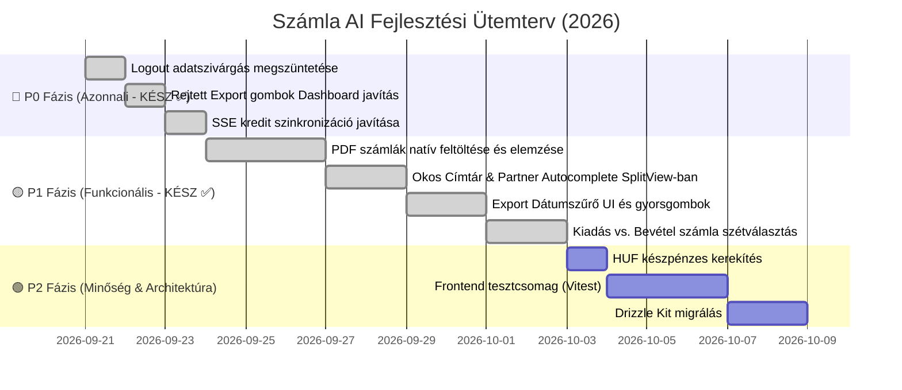

# 🚀 Számla AI — Rendszerszintű Átvilágítás és Fejlesztési Javaslatok (2026)

> **Dokumentum:** `FEJLESZTESI_JAVASLATOK.md`  
> **Dátum:** 2026. szeptember 21.  
> **Projekt:** Számla AI (Hono + TypeScript backend, Astro + DaisyUI frontend, PostgreSQL + MinIO + Stripe + Google Gemini AI: `gemini-3.5-flash-lite`)  
> **Cél:** A teljes kódbázis (backend, frontend, shared, adatbázis, deployment) átvilágítása alapján javasolt javítások, hiányosságok, architektúrális optimalizációk és üzleti lehetőségek részletes, azonnal kivitelezhető összefoglalása.

---

## 📊 Vezetői Áttekintés

A projekt az elmúlt fázisok során kiemelkedő biztonsági fejlesztéseken ment keresztül (AES-256-GCM kulcstitkosítás, SSRF és Open Redirect védelem, atomi kreditfoglalás, SQL szintű export szűrés, GDPR MinIO fizikai képtörlés, 48 sikeres backend teszt).

A friss rendszerszintű audit során azonban feltártunk **néhány kritikus rejtett konfigurációs és frontend logikai hibát**, valamint **jelentős üzleti és felhasználói élménybeli (UX) kitörési pontokat**, amelyek megvalósításával az alkalmazás piacvezetővé válhat a magyar kkv-k és könyvelők körében.

### Prioritási Mátrix

| Szint | Prioritás | Hibák / Fejlesztések száma | Fókuszterület |
|---|:---:|:---:|---|
| 🔴 **P0** | **Kritikus (Azonnali)** | 3 db | Kijelentkezési adatszivárgás, rejtett export gombok, SSE kredit szinkronizáció (Mind kész ✅) |
| 🟡 **P1** | **Magas (Kiemelt)** | 4 db | PDF számlák natív fogadása, okos partner címtár a szerkesztőben, export dátumszűrő UI, költség vs. bevétel szétválasztás (Mind kész ✅) |
| 🟢 **P2** | **Közepes (Architektúra)** | 5 db | Többoldalas számlák összefűzése, HUF készpénzkerekítés, frontend tesztek, Drizzle migrációk, Docker optimalizálás |
| 💡 **P3** | **Vízió & Innováció** | 3 db | NAV közvetlen szinkronizáció, dedikált számlafogadó email fiók, automatikus költségkategorizáció |

---

## 🔴 1. P0: Kritikus & Azonnal Javítandó Hibák (JAVÍTVA ✅)

### 1.1. [JAVÍTVA ✅] Kijelentkezéskor (Logout) nem ürül a frontend állapota és a DOM (Adatvédelmi hiba)
* **Érintett fájl:** [`frontend/src/scripts/auth.ts`](file:///d:/github/szamlazo-app/frontend/src/scripts/auth.ts#L260-L287)
* **A probléma:**
  Kijelentkezéskor a kód törölte a tokent a `localStorage`-ból, de a `state.lastProcessedResults`, a `state.inputItemsCache`, valamint a korábban betöltött számlák kártyái a `#resultsWrapper` DOM-jában **változatlanul megmaradtak a memóriában és a böngészőben**!
  Ha a felhasználó nem töltötte újra az oldalt (F5), vagy másvalaki ült le a géphez egy irodában, a korábbi fiók összes bizalmas számlája, partnere és pénzügyi adatai láthatóak maradtak.
* **Megvalósított megoldás:**
  A kijelentkezéskor a rendszer teljes körűen törli az összes állapotot (`lastProcessedResults`, `inputItemsCache`, `selectedFiles`), felszabadítja az Object URL-eket (`clearObjectURLs()`), újrahívja a `renderResultsCards()` és `renderPreviews()` függvényeket (így a `#resultsWrapper` azonnal kiürül), elrejti a folyamatjelzőket és az export eszköztárat, garantálva a teljes adatvédelmi elszigetelést.

---

### 1.2. [JAVÍTVA ✅] Rejtett Export gombok a betöltött számláknál (Dashboard UX hiba)
* **Érintett fájl:** [`frontend/src/components/Dashboard.astro`](file:///d:/github/szamlazo-app/frontend/src/components/Dashboard.astro#L238-L278), [`frontend/src/scripts/invoice-cards.ts`](file:///d:/github/szamlazo-app/frontend/src/scripts/invoice-cards.ts#L192-L215)
* **A probléma:**
  A `#exportCsvBtn` és `#exportRlbBtn` gombok a `#statusAlert` folyamatjelző tárolóban voltak, aminek alapértelmezetten `hidden` osztálya volt. Betöltött számláknál a gombokról ugyan lekerült a `hidden`, de a szülő tároló rejtve maradt, így az export gombok láthatatlanok voltak meglévő számláknál.
* **Megvalósított megoldás:**
  Létrehoztunk egy önálló, elegáns `#invoicesToolbar` számlalista műveleti sávot a `#resultsWrapper` fölött, amely automatikusan megjelenik, amint legalább egy számla van az adatbázisban. Élő számladarabszám jelvénnyel (`#invoicesCountBadge`) látja el a listát, és a CSV illetve RLB-60 export gombok mostantól közvetlenül és megbízhatóan elérhetők a bejelentkezés után azonnal.

---

### 1.3. [JAVÍTVA ✅] Kredit frissítési SSE eseménynév eltérés
* **Érintett fájlok:**
  * [`backend/src/routes/parse.ts`](file:///d:/github/szamlazo-app/backend/src/routes/parse.ts#L64-L70)
  * [`frontend/src/scripts/parse-stream.ts`](file:///d:/github/szamlazo-app/frontend/src/scripts/parse-stream.ts#L225-L235)
* **A probléma:**
  A backend az indításkor `currentCredits`-t küldött, míg a frontend a `remainingCredits`-t várta a `start` SSE eseményben, emiatt a kredit levonása a fejlécben nem látszódott azonnal a feldolgozás indításakor, csak a legvégén.
* **Megvalósított megoldás:**
  Kétoldalúan szinkronizálva: a backend a `start` esemény payloadjában mind a `currentCredits`, mind a `remainingCredits` mezőt kiküldi, a frontend pedig a `parsed.remainingCredits ?? parsed.currentCredits` feloldást alkalmazza, így az azonnali zárolás valós időben megjelenik a navigációs sávban.

---

## 🟡 2. P1: Kiemelt Funkcionális & Felhasználói Élmény (UX) Bővítések (JAVÍTVA ✅)

### 2.1. [JAVÍTVA ✅] PDF formátumú számlák natív fogadása és feldolgozása
* **Érintett fájlok:**
  * [`backend/src/services/gemini.ts`](file:///d:/github/szamlazo-app/backend/src/services/gemini.ts)
  * [`backend/src/lib/s3.ts`](file:///d:/github/szamlazo-app/backend/src/lib/s3.ts)
  * [`frontend/src/components/Dashboard.astro`](file:///d:/github/szamlazo-app/frontend/src/components/Dashboard.astro)
  * [`frontend/src/scripts/upload.ts`](file:///d:/github/szamlazo-app/frontend/src/scripts/upload.ts)
  * [`frontend/src/components/modals/SplitViewModal.astro`](file:///d:/github/szamlazo-app/frontend/src/components/modals/SplitViewModal.astro)
  * [`frontend/src/scripts/split-view.ts`](file:///d:/github/szamlazo-app/frontend/src/scripts/split-view.ts)
* **Megvalósított megoldás:**
  1. **Frontend feltöltő & Előnézet:** A DropZone és a rejtett fileInput elfogadja az `application/pdf` fájlokat (`accept="image/*,application/pdf"`). Feltöltéskor a PDF-ek nem törött ``-ként, hanem elegáns piros PDF kártyaként jelennek meg a feltöltési előnézetben, kijelezve a fájlméretet és típusát.
  2. **Split View beágyazott PDF megjelenítő:** A Split View modál tartalmaz egy `<iframe id="modalPdfViewer">` komponenst; ha a megnyitott bizonylat PDF, a kép helyett az interaktív PDF néző nyílik meg, és a fejléc kiírja: "Eredeti PDF számla".
  3. **Backend & Gemini integráció:** A `resolveImageBuffer` és `fetchWithSsrfProtection` kezeli és átengedi az `application/pdf` MIME típust. A Gemini 3.5 Flash Lite modellhez inline data-ként küldjük be a PDF bájtokat. Az S3 feltöltő (`uploadInvoiceBuffer`) a MIME típus alapján `.pdf` kiterjesztést ad a tárolt objektumnak.

---

### 2.2. [JAVÍTVA ✅] Okos Címtár & Partner Memória a Split View Szerkesztőben
* **Érintett fájlok:**
  * [`backend/src/routes/partners.ts`](file:///d:/github/szamlazo-app/backend/src/routes/partners.ts)
  * [`frontend/src/components/modals/SplitViewModal.astro`](file:///d:/github/szamlazo-app/frontend/src/components/modals/SplitViewModal.astro)
  * [`frontend/src/scripts/partner-suggest.ts`](file:///d:/github/szamlazo-app/frontend/src/scripts/partner-suggest.ts)
  * [`frontend/src/scripts/split-view.ts`](file:///d:/github/szamlazo-app/frontend/src/scripts/split-view.ts)
* **Megvalósított megoldás:**
  1. **Okos API végpont:** A `GET /api/partners/suggest?q=...` kibővült: nem csupán partnerneveket ad vissza, hanem a felhasználó korábbi számláiból kinyert teljes partnerprofilt (`name`, `taxNumber`, `country`, `zip`, `city`, `address`, `email`).
  2. **Split View Autocomplete:** A Vevő neve mező (`#edit_vevo_neve`) alá bekerült a lebegő `#splitPartnerSuggestions` konténer.
  3. **Automatikus mezőkitöltés:** Gépeléskor a rendszer 250ms debouncinggal lekéri a releváns korábbi partnereket. Kattintásra vagy Enterre azonnal kitölti az adószámot (`#edit_vevo_adoszam`), országot, irányítószámot (`#edit_vevo_iranyitoszam`), települést (`#edit_vevo_telepules`), címet (`#edit_vevo_cim`) és email címet (`#edit_vevo_email`), azonnali `input` eseményeket és vizuális visszajelzést (toast) generálva.

---

### 2.3. [JAVÍTVA ✅] Export Dátumszűrő Felület (Időszaki Könyvelői Zárás)
* **Érintett fájlok:**
  * [`frontend/src/components/Dashboard.astro`](file:///d:/github/szamlazo-app/frontend/src/components/Dashboard.astro)
  * [`frontend/src/scripts/export.ts`](file:///d:/github/szamlazo-app/frontend/src/scripts/export.ts)
* **Megvalósított megoldás:**
  1. **Szűrősáv a számlalista tetején:** Az `#invoicesToolbar` sávba beépült a `#exportFromDate` és `#exportToDate` dátumválasztó mezőpár.
  2. **Egykattintásos gyorsgombok (.export-preset-btn):**
     * „Összes számla”: Dátumok törlése, teljes előzmény exportálása.
     * „Ez a hónap”: Aktuális hónap 1. napjától a mai napig.
     * „Előző hónap”: Az előző naptári hónap első napjától az utolsó napjáig.
     * „Ez az év”: Aktuális év január 1-jétől a mai napig.
  3. **Paraméterezett letöltések:** A CSV és RLB-60 gombok (`triggerBackendCsvDownload`, `triggerBackendRlbDownload`) automatikusan átadják a kiválasztott `from` és `to` ISO dátum stringeket a backendnek, így a könyvelő pontos havi vagy éves záróanyagot kap.

---

### 2.4. [JAVÍTVA ✅] Költségszámla (Bejövő) vs. Értékesítési Számla (Kimenő) Megkülönböztetés
* **Érintett fájlok:**
  * [`backend/src/db/schema.ts`](file:///d:/github/szamlazo-app/backend/src/db/schema.ts) & [`backend/src/db/index.ts`](file:///d:/github/szamlazo-app/backend/src/db/index.ts)
  * [`backend/src/settings.ts`](file:///d:/github/szamlazo-app/backend/src/settings.ts)
  * [`frontend/src/components/modals/SettingsModal.astro`](file:///d:/github/szamlazo-app/frontend/src/components/modals/SettingsModal.astro) & [`frontend/src/scripts/settings.ts`](file:///d:/github/szamlazo-app/frontend/src/scripts/settings.ts)
  * [`frontend/src/scripts/state.ts`](file:///d:/github/szamlazo-app/frontend/src/scripts/state.ts) & [`frontend/src/scripts/auth.ts`](file:///d:/github/szamlazo-app/frontend/src/scripts/auth.ts)
  * [`shared/types.ts`](file:///d:/github/szamlazo-app/shared/types.ts)
  * [`frontend/src/scripts/invoice-cards.ts`](file:///d:/github/szamlazo-app/frontend/src/scripts/invoice-cards.ts)
  * [`frontend/src/components/modals/SplitViewModal.astro`](file:///d:/github/szamlazo-app/frontend/src/components/modals/SplitViewModal.astro) & [`frontend/src/scripts/split-view.ts`](file:///d:/github/szamlazo-app/frontend/src/scripts/split-view.ts)
* **Megvalósított megoldás:**
  1. **Saját Cég profil:** A felhasználói beállításokban megadható a saját cégnév és saját adószám (`companyName`, `companyTaxNumber`), ami perzisztálódik az adatbázisban és bejelentkezéskor automatikusan betöltődik.
  2. **Intelligens iránydetektálás (`detectInvoiceDirection`):**
     * Ha a számla kiállítója megegyezik a saját céggel / adószámmal: `outgoing` (Kimenő számla).
     * Ha a számla vevője a saját cég / adószám (vagy külső szállítótól érkezett számla/nyugta): `incoming` (Költségszámla).
  3. **Kártyajelvények és védett műveletek:**
     * A számlakártyákon megjelenik az `📥 Költségszámla` vagy `📤 Kimenő számla` jelvény.
     * Költségszámla esetén a Split View modálban megjelenik egy kék információs sáv (`#incomingInvoiceNotice`), a gomb átvált "Könyvelésre jóváhagyva & Mentés"-re, és a Számlázz.hu kiállítási szekció automatikusan elrejtésre kerül, megelőzve a téves kettős számlázást.
     * A számla iránya a Split View-ban kézzel is bármikor átállítható az `#edit_invoice_direction` választóval.

---

## 🟢 3. P2: Architektúra, Kódminőség & Üzemeltetés

### 3.1. Többoldalas számlák és kötegelt blokkok összefűzése
* **Probléma:**
  Egy 3 oldalas Telekom számlát a rendszer jelenleg 3 különálló számlaként dolgoz fel, 3 kreditet levonva, a végösszegeket megháromszorozva.
* **Javaslat:**
  Fájlfeltöltéskor lehessen kijelölni: „Ezek a képek egyetlen többoldalas számlához tartoznak”, vagy PDF esetén a teljes PDF-et egyetlen kontextusként küldje be a Gemini-nek.

---

### 3.2. HUF Készpénzkerekítés (5 Ft-os szabály a magyar jogszabályok szerint)
* **Jogszabály:** A forintban kiállított készpénzes számlák végösszegét a kerekítés szabályai szerint 0-ra vagy 5-re kell kerekíteni (1, 2 Ft -> 0; 3, 4 Ft -> 5; 6, 7 Ft -> 5; 8, 9 Ft -> 0).
* **Javaslat:**
  A `split-view.ts` és `szamlazz-integration.ts` fizetési mód logikájában: ha a fizetési mód `Készpénz` és a pénznem `HUF`, alkalmazzuk a hivatalos kerekítési függvényt a fizetendő bruttó végösszegre.

---

### 3.3. Drizzle ORM Migrációk automatizálása (`drizzle-kit migrate`)
* **Jelenlegi állapot:**
  Az `backend/src/db/index.ts`-ben az `initDatabase()` kézzel megírt `client\CREATE TABLE IF NOT EXISTS...\` parancsokat futtat minden szerverindításkor.
* **Javaslat:**
  A sémamódosításokat szervezzük át a Drizzle hivatalos migrációs folyamatába (`drizzle-kit generate` és `migrate(db, { migrationsFolder: './drizzle' })`), így a mezőváltoztatások reprodukálhatók és automatizálhatók a CI/CD folyamatban.

---

### 3.4. Frontend Automatizált Egységtesztek (Vitest)
* **Jelenlegi állapot:**
  A backend rendelkezik 48 futó és sikeres Vitest teszttel (`tests/`). A frontend `src/scripts` moduljaira (számítások, formázások, HTML sanitization, állapotkezelés) viszont nincs automatizált tesztcsomag.
* **Javaslat:**
  Frontend tesztek beállítása:
  * `sanitize.test.ts`: XSS elleni escapeHtml ellenőrzése.
  * `invoice-cards.test.ts`: `formatCurrency()` és ÁFA számítási tesztek.
  * `split-view.test.ts`: Tételsorok és bruttó végösszeg kalkulációjának matematikai tesztelése.

---

### 3.5. Docker Frontend Multi-Stage Build & Méretcsökkentés
* **Jelenlegi állapot:**
  A `Dockerfile.frontend` az Astro `preview` szerverét futtatja Node.js környezetben, megtartva a teljes forrást és a Node futtatókörnyezetet (~500 MB méret).
* **Javaslat:**
  Mivel az Astro projekt statikus kimenetet generál (`dist/`), a második szakaszban egy minimalista Caddy vagy Nginx Alpine konténer (~25 MB) szolgálhatná ki az eszközöket, jelentősen csökkentve a memóriahasználatot és a szerverindulási időt.

---

## 💡 4. P3: Termékfejlesztési Roadmap (Következő Nagy Dobások)

### 4.1. NAV Online Számla Közvetlen Bejövő Lekérdezés (Auto-Import)
* **Koncepció:**
  A Beállításokban a felhasználó már megadhatja a NAV technikai felhasználó adatait.
  Egy új gomb: „Számlák letöltése a NAV-ból”.
  A backend a NAV Online Számla 3.0 API `queryInvoiceDigest` és `queryInvoiceData` végpontjain lekéri az elmúlt 30 napban a cég nevére kiállított összes bejövő számlát XML-ben, amit az AI vagy XML parser azonnal rögzít. A vállalkozónak csak a külföldi vagy áfamentes papírblokkokat kell fotóznia.

### 4.2. Dedikált Bejövő Számlafogadó Email Cím
* **Koncepció:**
  Minden előfizető kap egy egyedi email címet (pl. `cegem-szamla@szamlazzjol.hu`).
  A könyvelési anyagok és szolgáltatói számlák továbbíthatók erre a címre; egy Mailgun vagy AWS SES webhook automatikusan kibontja a PDF mellékletet, lefuttatja a számlafelismerést és elhelyezi a felhasználó dashboardján jóváhagyásra váró számlaként.

### 4.3. Automatikus Költséghely Kategorizáció és Könyvelői Címkézés
* **Koncepció:**
  A Gemini AI a tételek és a partner alapján automatikusan felcímkézi a költségeket:
  * `Üzemanyag & Utazás` (Shell, MOL, MÁV)
  * `Informatika & Szoftver` (Google, Adobe, GitHub)
  * `Irodaszer & Rezsi` (Praktiker, MVM)
  * `Alvállalkozói díjak`
  A CSV exportban egy külön oszlopban megjelenik a kategória, ami a könyvelőprogramokban automatikus kontírozást tesz lehetővé.

---

## 🛠️ Javasolt Megvalósítási Ütemterv

---

*A dokumentum a projekt teljes forráskódjának elemzése alapján készült, karbantartója a Számla AI fejlesztői csapata.*
