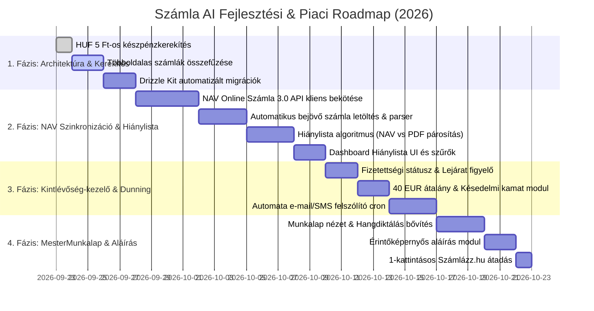

# 🧭 Számla AI — Integrált B2B Micro-SaaS Mesterterv (Master Plan 2026)

> **Dokumentum:** `plans/PLAN.md`  
> **Verzió:** 4.1.0 (Master Roadmap — Netcup + Coolify Edition)  
> **Dátum:** 2026. szeptember 22.  
> **Infrastruktúra:** **Netcup VPS** (4 vCPU, 8 GB RAM, 160 GB SSD, Németországi adatközpont, ~15 ms ping HU felé) + **Coolify PaaS** (önkiszolgáló Docker felügyelet, Traefik SSL reverse proxy, beépített mentések).  
> **Alapozó források:** `plans/` (`AUDIT_ES_FEJLESZTESI_TERV.md`, `FEJLESZTESI_JAVASLATOK.md`, `IDEAS.md`, `MAGYAR_SAAS_PIACKUTATAS_8GB_VPS.md`, `SECURITY_AUDIT.md`, `ADATVEDELEM.md`, `ASZF.md`)  
> **Cél:** A meglévő, auditált és biztonságilag megerősített AI számlafeldolgozó motorra épülő, Netcup + Coolify környezetben futó, magas megtérülésű (Hard ROI & Compliance) magyar B2B SaaS platform megvalósítási terve.

---

## 🏗️ 1. Kiindulópont & Meglévő Architektúrális Alapok

A projekt korábbi fázisaiban a kritikus biztonsági és működési rések **100%-ban javításra kerültek és teszteltek** (48 sikeres backend teszt):

| Kész Rendszerelem | Implementált Megoldás | Állapot |
|---|---|:---:|
| **AI OCR & Dokumentumkezelés** | Google Gemini Vision (`gemini-3.5-flash`), PDF natív fogadás, képek MinIO/S3 tárolása, SSE valós idejű stream | KÉSZ ✅ |
| **Számlázási Integráció** | Számlázz.hu Agent közvetlen számlakiállítás, fizetési mód detektálás, Áfa tv. szerinti szigorú mezővalidáció | KÉSZ ✅ |
| **Könyvelési Export** | SQL-szintű dátumszűrés, CSV Formula Injection védelem, tiszta **RLB-60** formázó motor | KÉSZ ✅ |
| **Biztonság & Titkosítás** | SSRF/Open Redirect védelem, AES-256-GCM kulcstitkosítás, maszkolt API beállítások, Hono bodyLimit (30MB), Rate limiter | KÉSZ ✅ |
| **Pénzügy & Monetizáció** | Stripe kártyás fizetés, atomi feltételes kreditfoglalás (`SELECT FOR UPDATE` jellegű double-spend védelem) | KÉSZ ✅ |
| **Felhasználói Élmény (UX)** | Split View interaktív szerkesztő, beágyazott PDF néző, hangalapú diktálás (Web Speech API), intelligens partner memória | KÉSZ ✅ |
| **Jogi & Adatvédelem** | B2B ÁSZF, GDPR adatkezelési tájékoztató, tranzakciós fióktörlés fizikai S3 képmegsemmisítéssel | KÉSZ ✅ |

> [!NOTE]
> **Aktuális szerverterhelés:** ~350 MB RAM a teljes stack (PostgreSQL + Hono API + Astro + MinIO).  
> A célul kitűzött **8 GB VPS kapacitásának alig 4.5%-a van kihasználva**, ami óriási mozgásteret biztosít a közvetlenül ráépülő SaaS moduloknak!

---

## 🎯 2. A Stratégiai Termékvízió: Számla AI Platform

Ahelyett, hogy a szoftver csupán egy "kézi számla OCR eszköz" maradna, a meglévő technológiára építve egy **háromlábú, integrált B2B KKV és Könyvelői Platformmá** bővül:

```
┌─────────────────────────────────────────────────────────────────────────────────────────┐
│                                   SZÁMLA AI PLATFORM                                    │
│             Hono Backend + Astro SSR UI + PostgreSQL + Redis + Gemini AI                │
└───────────────┬───────────────────────────┬───────────────────────────┬─────────────────┘
                │                           │                           │
                ▼                           ▼                           ▼
    ┌──────────────────────┐    ┌──────────────────────┐    ┌──────────────────────┐
    │ 🏛️ 1. PILLÉR:         │    │ ⏰ 2. PILLÉR:         │    │ 🛠️ 3. PILLÉR:         │
    │ KönyvelőHub & NAV    │    │ SzámlaŐr Kintlévőség-│    │ MesterLap Szakember  │
    │ Ingestion Portál     │    │ kezelő & Dunning Bot │    │ PWA & Munkalap       │
    │ (Könyvelőknek & KKV) │    │ (Ptk. kamat + 40 EUR)│    │ (Terepi munkavégzés) │
    └──────────────────────┘    └──────────────────────┘    └──────────────────────┘
```

---

## 🧩 3. Az Új SaaS Modulok Részletes Tervezete

### 🏛️ Modul 1: Könyvelői NAV & Bizonylat Ingestion HUB ("KönyvelőHub")
*A meglévő RLB-60 exportáló és számla adatmodell közvetlen kiterjesztése könyvelőirodáknak.*

* **NAV Online Számla 3.0 Kétoldali Szinkronizáció:**
  * A `schema.ts`-ben már előkészített `navTechnicalUser`, `navSignKey`, `navExchangeKey` aktiválása.
  * Havi/heti háttérszinkron: a NAV hivatalos REST API-ján (`queryInvoiceDigest` + `queryInvoiceData`) lehívja az összes bejövő (költség) és kimenő számla XML adatát.
* **Intelligens Bizonylat-párosítás & Hiánylista:**
  * Összeveti a NAV-ból érkező számlákat a felhasználó által feltöltött PDF/fotó állományokkal (adószám + számlaszám + összeg alapján).
  * **Automata Hiánylista Riport:** Vizuálisan és emailben jelzi a hiányzó bizonylatokat:  
    *🚨 „A NAV szerint a Praktikertől érkezett 45.000 Ft-os számlád, de még nem töltötted fel a PDF-et!”*
* **Kibővített Könyvelői Exportok:**
  * Az elkészült RLB-60 mellé **Novitax** és **Kulcs-Könyvelés** formátumok bevezetése.
* **Dedikált Számlafogadó Email Inbox (Roadmap P3):**
  * Minden cég kap egy egyedi email címet (pl. `cegem@szamla-ai.hu`), ahova a beszállítók közvetlenül küldhetik az e-számlákat; a backend automatikusan kinyeri és rögzíti a mellékleteket.

---

### ⏰ Modul 2: Kintlévőség-kezelő & Automata Fizetési Felszólító ("SzámlaŐr")
*Közvetlen pénzbehajtási megtérülést (Hard ROI) adó modul minden magyar számlázó cégnek.*

* **Fizetési Státusz Menedzsment:**
  * Számlák állapota: `fizetve` (paid), `határidőn_belül` (pending), `lejárt` (overdue).
* **Automatizált, Jogilag Pontos Felszólítási Lépcsők (BullMQ cron):**
  * **-2 nappal lejárat előtt:** Udvarias emlékeztető e-mail/SMS („Hamarosan esedékes a számla...”).
  * **Lejárat napján:** Figyelmeztetés azonnali banki fizetési QR-kóddal (Magyar Nemzeti Bank azonnali átutalási szabvány) és SimplePay/Barion linkkel.
  * **+8 napos késedelem:** Hivatalos fizetési felszólítás a Ptk. szerinti **késedelmi kamat** és a törvényi **40 EUR behajtási költségátalány (~16.000 Ft)** automatikus felszámításával!
  * **+30 napos késedelem:** 1-kattintásos FMH (Fizetési Meghagyás) jogi adatcsomag export közjegyzői / ügyvédi eljáráshoz.

---

### 🛠️ Modul 3: MesterMunkalap & Helyszíni Gyorsajánlat ("MesterLap")
*A meglévő mobil számlakészítő, hangdiktáló és partnerkezelő felületek vertikális kiterjesztése szakembereknek (klímások, villanyszerelők, szervizek).*

* **Digitális Munkalap (Worksheet):**
  * Új felület: Munkalap létrehozása a helyszínen mobilon.
  * A meglévő [`voice.ts`](file:///d:/github/szamlazo-app/frontend/src/scripts/voice.ts) modul segítségével a szakember **hanggal bediktálja** az elvégzett munkát és felhasznált anyagokat.
  * Előtte-utána fotók készítése telefonnal (MinIO/S3 tárolóba).
* **Érintőképernyős Aláírás (Touch Signature):**
  * HTML5 Canvas komponens a Split View-ban: a megrendelő ujjal aláírja a munkalapot a telefon képernyőjén.
* **Azonnali Számlázás:**
  * A munkalap lezárásakor egy gombnyomásra kiállítja a számlát a meglévő [`szamlazz-integration.ts`](file:///d:/github/szamlazo-app/backend/src/szamlazz-integration.ts) modulon keresztül.
* **Éves Szerviz Emlékeztető:**
  * 11 hónap múlva automata SMS a vevőnek (pl. klímatisztítás, kazán karbantartás).

---

### 👥 Modul 4: Multi-Tenant & Szervezeti Jogosultságok (`Organization`)
*Az `IDEAS.md`-ben megfogalmazott csoportmunka megvalósítása.*

* **Hierarchikus Modell:**
  * `organizations` és `organization_members` táblák.
  * **Szerepkörök (Roles):**
    * `owner / admin` (Cégvezető / Irodavezető): Teljes hozzáférés, számlázási beállítások, előfizetés.
    * `member / uploader` (Alkalmazott / Szaki): Csak feltölt és szerkeszt, saját számláit látja.
    * `accountant` (Külső Könyvelő): Látja az összes számlát, jóváhagy, hiánylistát kezel és exportál (RLB/CSV).
* **Könyvelői Fiók (Multi-Client Switcher):**
  * Egy könyvelő a saját bejelentkezésével több ügyfélcég között válthat egyetlen kattintással a fejlécben.

---

## ⚙️ 4. Technikai Adósságok és Architektúrális Feladatok (P2 Zóna)

A meglévő tervekben azonosított minőségi javítások beépítése:

1. **HUF Készpénzkerekítés (5 Ft-os szabály):**
   * A magyar jogszabályok szerinti kerekítés beépítése a `split-view.ts` és `szamlazz-integration.ts` fájlokba, ha a fizetési mód Készpénz és a pénznem HUF.
2. **Többoldalas számlák összefűzése:**
   * Több képfájl egyetlen számlaként történő feldolgozása, hogy a többoldalas szolgáltatói számlák (Telekom, MVM) ne vonjanak le többszörös kreditet és ne duplikálják a végösszeget.
3. **Drizzle ORM Migrációk Rendszerezése:**
   * Átállás az `initDatabase()` kézi `CREATE TABLE` parancsairól a `drizzle-kit generate` és `drizzle-kit migrate` hivatalos folyamatra.
4. **Frontend Egységtesztek (Vitest):**
   * A frontend scriptjeinek (`sanitize.ts`, `split-view.ts` számítások, `invoice-cards.ts`) lefedése automatizált tesztekkel.
5. **Docker Multi-Stage Build Optimalizáció:**
   * Az Astro frontend kiszolgálása egy könnyű Caddy/Nginx Alpine konténerből (~25 MB) a Node preview szerver helyett.

---

## 🗄️ 5. Adatbázis Séma Bővítési Terv (PostgreSQL + Drizzle)

```ts
// Tervezett új táblák és mezők a backend/src/db/schema.ts-ben:

// 1. Szervezeti / Cég modell könyvelőknek és KKV-knak
export const organizations = pgTable('organizations', {
  id: text('id').primaryKey().$defaultFn(() => crypto.randomUUID()),
  name: text('name').notNull(),
  taxNumber: text('tax_number'),
  navTechnicalUser: text('nav_technical_user'),
  navTechnicalPassword: text('nav_technical_password'), // AES-256-GCM
  navSignKey: text('nav_sign_key'),                     // AES-256-GCM
  navExchangeKey: text('nav_exchange_key'),             // AES-256-GCM
  createdAt: timestamp('created_at').defaultNow().notNull(),
});

export const organizationMembers = pgTable('organization_members', {
  id: text('id').primaryKey().$defaultFn(() => crypto.randomUUID()),
  orgId: text('org_id').references(() => organizations.id).notNull(),
  userId: text('user_id').references(() => users.id).notNull(),
  role: text('role').default('member').notNull(), // 'owner' | 'admin' | 'member' | 'accountant'
});

// 2. Számlák kiegészítése fizetettséggel, NAV szinkronnal és munkalappal
// Új mezők az invoices táblában:
// - orgId: text('org_id').references(() => organizations.id)
// - paymentStatus: text('payment_status').default('pending') // 'pending' | 'paid' | 'overdue'
// - navTransactionId: text('nav_transaction_id')
// - hasAttachment: boolean('has_attachment').default(true)
// - dunningLevel: integer('dunning_level').default(0) // Felszólítási fokozat (0-4)
// - lastDunningAt: timestamp('last_dunning_at')

// 3. Munkalap tábla szakembereknek
export const worksheets = pgTable('worksheets', {
  id: text('id').primaryKey().$defaultFn(() => crypto.randomUUID()),
  userId: text('user_id').references(() => users.id).notNull(),
  clientName: text('client_name').notNull(),
  clientAddress: text('client_address'),
  description: text('description').notNull(),
  signatureUrl: text('signature_url'), // S3 tárolt digitális aláírás
  status: text('status').default('draft'), // 'draft' | 'signed' | 'invoiced'
  invoiceId: text('invoice_id').references(() => invoices.id),
  createdAt: timestamp('created_at').defaultNow().notNull(),
});
```

---

## 📅 6. Megvalósítási Ütemterv (Roadmap)



---

## 🖥️ 7. Netcup (160 GB SSD / 8 GB RAM) + Coolify Erőforrás & Tárhely Profil

A **Netcup VPS + Coolify** felállás kiemelkedően ideális és költséghatékony (kb. 6–8 € / hó):
* **Coolify beépített Traefik proxy:** Automatikus Let's Encrypt SSL tanúsítványok, zero-downtime Git push alapú deployok.
* **160 GB SSD tárhely kihasználása:** A belső MinIO konténer a helyi SSD-re mentheti az összes számlaképet és PDF-et. Egy átlagos számlakép/PDF ~200 KB, így 100 GB helyi tárhelyen **több mint 500 000 számla tárolható 0 Ft felhős S3 költséggel**, 100%-ban EU / németországi adatvédelemmel (GDPR).

| Komponens / Konténer | RAM Használat | Lemezhasználat (160 GB SSD) | Coolify & Optimalizációs Szerep |
|---|:---:|:---:|---|
| **Coolify Core + Traefik** | ~ 450 – 550 MB | ~ 15 GB (Docker + OS) | Reverse proxy, automatikus SSL, Git deploy webhookok |
| **PostgreSQL 16 (Coolify DB)** | ~ 1.0 – 1.2 GB | ~ 10 – 20 GB | Indexelt JSONB számlák, Drizzle ORM, napi auto-backup |
| **MinIO (Coolify Service)** | ~ 150 – 200 MB | ~ 80 – 100 GB | Helyi S3 kompatibilis számlakép-tárhely (ingyenes) |
| **Redis 7 (Coolify DB)** | ~ 100 – 150 MB | ~ 1 GB | BullMQ feladatsorok (NAV szinkron, dunning cron) |
| **Hono Backend API** | ~ 250 – 350 MB | < 1 GB | Két Node.js worker folyamat |
| **Astro Frontend** | ~ 100 – 150 MB | < 500 MB | Docker konténerben futó SSR felület |
| **Összesen használt RAM** | **~ 2.2 – 2.6 GB** | **~ 110 – 135 GB** | **Megmarad ~5.4 GB RAM a Linux Page Cache-nek!** |
| **Összes havi infrastruktúra költség** | **~ 6 – 8 € / hó** | | **Netcup VPS bérleti díja (nincs rejtett felhőköltség!)** |

---

## 🏆 8. Összegzés & Következő Lépés

A tervek alapján a projekt a legstabilabb, legköltséghatékonyabb magyar SaaS platformmá fejlődhet.  
A kivitelezés első logikus és leggyorsabb lépése:
1. A **HUF készpénzkerekítés** és **többoldalas számla összefűzés** befejezése (1-2 nap).
2. A **NAV Online Számla 3.0 API szinkronizációs modul** megépítése a meglévő adatbázis mezőkre alapozva (elsőként tesztkörnyezetben / mock adatokkal).
