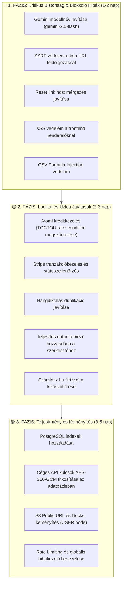

# 🛡️ Szamlazo-App — Átfogó Biztonsági, Hibaelemzési és Minőségi Audit

> **Dokumentum verzió:** 1.0.0  
> **Dátum:** 2026. szeptember 21.  
> **Projekt:** Számla AI (Hono + TypeScript backend, Astro + DaisyUI frontend, PostgreSQL + MinIO + Stripe + Gemini AI)  
> **Cél:** A teljes kódbázis biztonsági réseinek (exploits, vulnerabilities), üzleti logikai hibáinak (bugs), hardkódolt paramétereinek és architektúrális hiányosságainak részletes feltárása, javítási útmutatóval.

---

## 📊 Vezetői Összefoglaló (Executive Summary)

A projekt a korábbi moduláris refaktorálásnak köszönhetően strukturált és átlátható felépítésű, azonban a funkcionális mélyfúrás során **több kritikus biztonsági rés (SSRF, Stored/DOM XSS, Password Reset Poisoning)** és **üzleti logikai hiba (kredit versenyhelyzet, nem létező AI modellnév, tranzakcióhiány)** került azonosításra.

### Sérülékenységi Mátrix

| Kategória | Kritikus (P0) | Magas (P1) | Közepes (P2) | Alacsony / Észrevétel (P3) | Összesen |
|-----------|:---:|:---:|:---:|:---:|:---:|
| 🚨 **Biztonság & Exploitok** | 2 | 3 | 2 | 1 | **8** |
| 🐛 **Logikai & Működési Hibák** | 2 | 4 | 2 | 0 | **8** |
| ⚙️ **Hardcode & Konfiguráció** | 0 | 2 | 3 | 1 | **6** |
| 🏗️ **Architektúra & Teljesítmény**| 0 | 2 | 3 | 1 | **6** |
| **Összesen** | **4** | **11** | **10** | **3** | **28** |

---

## 🚨 1. Biztonsági Sérülékenységek & Exploit Kockázatok

### 1.1. [KRITIKUS] SSRF (Server-Side Request Forgery) Kép URL Feldolgozásakor
* **Érintett fájl:** [`backend/src/services/gemini.ts`](file:///d:/github/szamlazo-app/backend/src/services/gemini.ts#L118-L139)
* **Mechanizmus:**
  A `/api/parse-batch-stream` végponton keresztül, ha a beküldött tétel típusa `url`, a szerver közvetlenül meghívja a `fetch(item.data)` függvényt:
  ```ts
  // backend/src/services/gemini.ts:118
  const response = await fetch(item.data, {
    headers: { 'User-Agent': '...', 'Accept': 'image/...' }
  });
  const arrayBuffer = await response.arrayBuffer();
  ```
  A kód nem ellenőrzi az URL sémáját, nincs domain/IP feketelista, nincs belső hálózati tiltás, és nincs maximális letöltési méretkorlát.
* **Támadási forgatókönyv (Exploit):**
  1. **Felhős infrastruktúra metaadat lopás:** Egy bejelentkezett felhasználó beküldi a `http://169.254.169.254/latest/meta-data/` címet, amivel AWS/GCP IAM secret tokeneket és ideiglenes hitelesítő adatokat csalhat ki a szerverből.
  2. **Belső hálózat portszkennelés:** Belső Docker és helyi szolgáltatások (`http://127.0.0.1:5432` PostgreSQL, `http://minio:9000`, `http://coolify:...`) vizsgálhatók a válaszidők és HTTP hibakódok alapján.
  3. **Denial of Service (OOM Crash):** Egy 5-10 GB méretű fájlra vagy végtelen streamre mutató link beküldésével a backend `response.arrayBuffer()` hívása kifogyasztja a memóriát, és lelövi a Node processzt.
* **Javítási javaslat:**
  * Protokoll szűrése: szigorúan csak `http:` és `https:`.
  * IP-cím feloldás és privát tartományok blokkolása: loopback (`127.0.0.0/8`), RFC 1918 (`10.0.0.0/8`, `172.16.0.0/12`, `192.168.0.0/16`), link-local (`169.254.0.0/16`).
  * `AbortSignal.timeout(8000)` és max 10MB Content-Length ellenőrzés a válasz bufferelése előtt.

---

### 1.2. [MAGAS] Jelszó-visszaállítási Link Mérgezés (Host Header / Origin Attack)
* **Érintett fájl:** [`backend/src/auth.ts`](file:///d:/github/szamlazo-app/backend/src/auth.ts#L177-L180)
* **Mechanizmus:**
  ```ts
  // Dinamikus link generálása az aktuális frontend URL alapján
  const origin = c.req.header('origin') || 'http://localhost:4321';
  const resetLink = `${origin}/?resetToken=${resetToken}`;
  ```
* **Támadási forgatókönyv (Exploit):**
  A támadó küld egy POST kérést a `/api/auth/forgot-password` végpontra a kiszemelt áldozat email címével, de a HTTP kérés fejlécében elhelyezi:
  `Origin: https://attacker-phishing.com`
  A backend a megbízható Resend email szolgáltatón keresztül kiküldi a hivatalos jelszó-visszaállító levelet az áldozatnak, amelyben a link:
  `https://attacker-phishing.com/?resetToken=7a8b9c...`
  Amikor az áldozat gyanútlanul a gombra kattint, a reset token átadódik a támadó szerverének, amivel a támadó azonnal megváltoztatja a jelszót és átveszi a fiókot.
* **Javítási javaslat:**
  A visszaállító link bázis-URL-jét kizárólag a szerveroldali biztonságos környezeti változóból (`process.env.FRONTEND_URL`) szabad felépíteni; a bejövő kérés fejléceit (`Origin`, `Host`, `X-Forwarded-Host`) figyelmen kívül kell hagyni.

---

### 1.3. [MAGAS] Többszörös Stored és DOM Cross-Site Scripting (XSS)
* **Érintett fájlok:**
  * [`frontend/src/scripts/invoice-cards.ts#L70, L97, L131-L134`](file:///d:/github/szamlazo-app/frontend/src/scripts/invoice-cards.ts#L70)
  * [`frontend/src/scripts/split-view.ts#L102, L230-L237`](file:///d:/github/szamlazo-app/frontend/src/scripts/split-view.ts#L102)
  * [`frontend/src/scripts/parse-stream.ts#L249`](file:///d:/github/szamlazo-app/frontend/src/scripts/parse-stream.ts#L249)
  * [`frontend/src/scripts/partner-suggest.ts#L47-L51`](file:///d:/github/szamlazo-app/frontend/src/scripts/partner-suggest.ts#L47)
* **Mechanizmus:**
  A beolvasott számlaadatok (`kiallito_neve`, `vevo_neve`, `szamlaszam`, `t.megnevezes`, `item.source`, `partner`) és a szerkesztési mezők értékei HTML escape-elés nélkül kerülnek beillesztésre az `innerHTML`-be:
  ```ts
  // invoice-cards.ts:97
  <h3 class="font-bold text-lg text-primary">
    ${d.kiallito_neve || "Ismeretlen kiállító"}
  </h3>
  ```
  ```ts
  // split-view.ts:102
  <input type="text" ... value="${t.megnevezes || ""}" />
  ```
* **Támadási forgatókönyv (Exploit):**
  Ha egy számlán a partner neve vagy tétel megnevezése kártékony kódot tartalmaz (pl. ``), vagy a felhasználó diktál egy HTML taget:
  1. A kód a DOM-ba illesztés pillanatában lefut az áldozat böngészőjében.
  2. Mivel az auth token a `localStorage`-ban van tárolva, az XSS script észrevétlenül ellopja a JWT session tokent.
  3. A támadó hozzáfér a felhasználó összes elmentett számlájához, letöltheti a MinIO képeket, és kiolvashatja a cég beállított NAV és Számlázz.hu API kulcsait!
* **Javítási javaslat:**
  Minden dinamikus szöveges adat kiírásakor kötelező a HTML karakterek kódolása:
  ```ts
  export function escapeHtml(str: unknown): string {
    if (str === null || str === undefined) return '';
    return String(str)
      .replace(/&/g, '&amp;')
      .replace(/</g, '&lt;')
      .replace(/>/g, '&gt;')
      .replace(/"/g, '&quot;')
      .replace(/'/g, '&#039;');
  }
  ```

---

### 1.4. [MAGAS] Érzékeny Céges API Kulcsok Plaintext Tárolása az Adatbázisban
* **Érintett fájlok:** [`backend/src/db/schema.ts#L11-L15`](file:///d:/github/szamlazo-app/backend/src/db/schema.ts#L11-L15), [`backend/src/settings.ts`](file:///d:/github/szamlazo-app/backend/src/settings.ts)
* **Mechanizmus:**
  A `szamlazz_hu_api_key`, `nav_technical_password`, `nav_sign_key`, és `nav_exchange_key` oszlopok sima, nyers szövegként tárolódnak a PostgreSQL `users` táblájában.
* **Kockázat:**
  Ezek a kulcsok feljogosítanak a cég nevében történő hivatalos számlakiállításra és a NAV Online Számla adatszolgáltatás teljes körű manipulálására. Ha az adatbázisról készült mentés (dump), naplófájl vagy kapcsolat kiszivárog, a támadók azonnal megszerezhetik a cégek éles számlázási hozzáféréseit.
* **Javítási javaslat:**
  A mezőket adatbázisba írás előtt szimmetrikus titkosítással (AES-256-GCM) kell kódolni, felolvasáskor pedig visszafejteni egy biztonságos szerveroldali `ENCRYPTION_KEY` segítségével.

---

### 1.5. [KÖZEPES] CSV Formula Injection (CWE-1236)
* **Érintett fájl:** [`backend/src/services/export-formatter.ts#L15-L18`](file:///d:/github/szamlazo-app/backend/src/services/export-formatter.ts#L15-L18)
* **Mechanizmus:**
  A CSV export tisztító függvénye mindössze az idézőjeleket duplázza meg:
  ```ts
  export function cleanFieldCSV(val: string | undefined | null): string {
    if (!val) return '""';
    return `"${String(val).replace(/"/g, '""')}"`;
  }
  ```
* **Támadási forgatókönyv (Exploit):**
  Ha egy beolvasott számla tétele vagy partnere `=CMD|' /C calc'!A0` vagy `@SUM(...)`, `+`, `-` jellel kezdődik, a könyvelő Excelben megnyitva a CSV-t képletrejtést vagy DDE (Dynamic Data Exchange) kódvégrehajtást szenvedhet el.
* **Javítási javaslat:**
  Ha a szöveges érték első karaktere `=`, `+`, `-`, `@`, `\t` vagy `\r`, a mező elé egy aposztrófot (`'`) kell illeszteni:
  ```ts
  let text = String(val).replace(/"/g, '""');
  if (/^[=+\-@\t\r]/.test(text)) {
    text = "'" + text;
  }
  return `"${text}"`;
  ```

---

### 1.6. [KÖZEPES] Sebességkorlátozás (Rate Limiting) és Brute-Force Védelem Hiánya
* **Érintett útvonalak:**
  * `POST /api/auth/login` (nincs brute-force védelem)
  * `POST /api/auth/forgot-password` (nincs email küldési korlát)
  * `POST /api/parse-batch-stream` és `POST /api/invoices/parse-text` (nincs hívási kvótavédelem)
* **Kockázat:**
  * Jelszószótáras támadások indíthatók a felhasználói fiókok ellen.
  * A Resend email API egyenlegét a támadók percek alatt kimeríthetik spameléssel.
  * A Gemini API kvóta és költségvetés túlterheléses hívásokkal kimeríthető.
* **Javítási javaslat:**
  In-memory vagy Redis alapú rate limiter bevezetése (pl. `@hono/rate-limiter` vagy egy egyszerű IP/User bucket middleware).

---

### 1.7. [ALACSONY] Nyitott Wildcard CORS Beállítás
* **Érintett fájl:** [`backend/src/index.ts#L23`](file:///d:/github/szamlazo-app/backend/src/index.ts#L23)
* **Kód:** `app.use('/*', cors());`
* **Kockázat:** Bármilyen doménről engedélyezi a kéréseket. Éles környezetben ajánlott origin whitelistet (`process.env.FRONTEND_URL`) beállítani.

---

## 🐛 2. Funkcionális Hibák & Üzleti Logikai Anomáliák

### 2.1. [KRITIKUS] Nem Létező Gemini Modellnév Beégetve
* **Érintett fájl:** [`backend/src/services/gemini.ts#L166, L240`](file:///d:/github/szamlazo-app/backend/src/services/gemini.ts#L166)
* **A hiba:**
  ```ts
  'https://generativelanguage.googleapis.com/v1beta/models/gemini-3.5-flash-lite:generateContent'
  ```
* **Következmény:** A Google Gemini API termékkínálatában **nincs** `gemini-3.5-flash-lite` modell. Minden kép- és szövegfeldolgozási hívás `404 Not Found` hibával azonnal elbukik.
* **Javítás:** Átírás a hivatalos, stabil `gemini-2.5-flash` modellre.

---

### 2.2. [MAGAS] Kredit Versenyhelyzet (Race Condition / TOCTOU Double Spend)
* **Érintett fájl:** [`backend/src/routes/parse.ts#L45, L90-L96, L137`](file:///d:/github/szamlazo-app/backend/src/routes/parse.ts#L45)
* **A hiba mechanizmusa:**
  1. A batch feldolgozás kezdetén a kód leellenőrzi a felhasználó kreditjeit a memóriában:
     ```ts
     if (user.monthlyCredits < items.length) return c.json({ error: 'Nincs elég...' }, 402);
     ```
  2. Ezután 10-30 másodpercig tart az AI feldolgozás.
  3. A sikeres számlák után a legvégén vonja le az összeget:
     ```ts
     monthlyCredits: sql`${users.monthlyCredits} - ${successCount}`
     ```
* **Következmény:**
  Ha a felhasználó 1 kredittel rendelkezik, és párhuzamosan elindít 10 kérést (akár 10 külön böngészőfülről), az összes kérés átcsúszik az 1. pont ellenőrzésén. A rendszer mind a 10 kérést (akár 100 számlát) feldolgozza, és a végén a kredit levonáskor a felhasználó egyenlege mélyen **negatívba csap át** (pl. `-9`).
* **Szöveges prompt anomália:** A `/invoices/parse-text` útvonalon a levonás az AI hívás *előtt* történik. Ha a Gemini elszáll, a felhasználó elveszíti a kreditjét, és nem kap számlát.
* **Javítás:**
  Atomi feltételes egyenleg-csökkentés az adatbázisban:
  ```sql
  UPDATE users 
  SET monthly_credits = monthly_credits - $1 
  WHERE id = $2 AND monthly_credits >= $1 
  RETURNING monthly_credits;
  ```
  Ha 0 sor frissült, a kérés azonnal elutasításra kerül.

---

### 2.3. [MAGAS] Adatbázis Tranzakció Hiánya a Stripe Jóváírásnál
* **Érintett fájl:** [`backend/src/billing.ts#L56-L77`](file:///d:/github/szamlazo-app/backend/src/billing.ts#L56-L77)
* **A hiba mechanizmusa:**
  A fizetési tranzakció rögzítése (`db.insert(payments)`) és a kreditek jóváírása (`db.update(users)`) külön fut, nincs `db.transaction()`-ben.
* **Következmény:**
  Ha a fizetési rekord beszúrása sikerül, de a kreditfrissítés elhasal (hálózati megszakadás, adatbázis timeout), a payment sor bent marad, a felhasználó **nem kapja meg a krediteket**, és az idempotencia-ellenőrzés miatt a webhook retry is úgy ítéli meg, hogy a session már fel van dolgozva (`alreadyProcessed: true`).
* **Javítás:**
  A teljes műveletet `db.transaction(async (tx) => { ... })` blokkba kell szervezni.

---

### 2.4. [MAGAS] Stripe Webhook Nem Ellenőrzi a Fizetés Státuszát
* **Érintett fájl:** [`backend/src/billing.ts#L192-L199`](file:///d:/github/szamlazo-app/backend/src/billing.ts#L192-L199)
* **A hiba:**
  `event.type === 'checkout.session.completed'` esetén közvetlenül jóváírja a kreditet, anélkül hogy megnézné, `session.payment_status === 'paid'`.
* **Következmény:**
  Késleltetett vagy aszinkron fizetési módoknál (pl. átutalás, SEPA) a checkout elkészülése még nem jelenti a pénz beérkezését; így a felhasználó még kifizetetlen tranzakcióra is megkaphatja a krediteket.

---

### 2.5. [KÖZEPES] Hangdiktálás Szövegduplikáció
* **Érintett fájl:** [`frontend/src/scripts/voice.ts#L64, L91-L93`](file:///d:/github/szamlazo-app/frontend/src/scripts/voice.ts#L64)
* **A hiba:**
  1. A felismerés közben `recognition.onresult`:
     `input.value = finalTranscript || current;` — beírja a felismert szöveget.
  2. A felismerés végén `recognition.onend`:
     `const existing = input.value.trim();`
     `input.value = existing ? existing + " " + finalTranscript.trim() : ...;`
* **Következmény:**
  A bediktált mondat kétszer jelenik meg a szövegdobozban (pl. *"Kovács Kft-nek számla Kovács Kft-nek számla"*).
* **Javítás:** Az `onend` eseményben ne fűzzük hozzá újra a `finalTranscript`-et, ha az `onresult` már beállította.

---

### 2.6. [KÖZEPES] Hiányzó Teljesítés Dátuma a Split View Modálban
* **Érintett fájlok:** [`frontend/src/components/modals/SplitViewModal.astro`](file:///d:/github/szamlazo-app/frontend/src/components/modals/SplitViewModal.astro), [`frontend/src/scripts/split-view.ts#L341-L355`](file:///d:/github/szamlazo-app/frontend/src/scripts/split-view.ts#L341)
* **A hiba:**
  A számlaszerkesztő modálban van Kelt (`kelt_datum`) és Fizetési határidő (`fizetesi_hatarido`), de **hiányzik a Teljesítés dátuma (`teljesites_datum`)**.
* **Következmény:**
  A magyar Áfa tv. (169. §) szerint a teljesítés időpontja kötelező számlaelem. A felhasználó a felületen nem látja és nem tudja korrigálni ezt a mezőt.
* **Javítás:** Input mező hozzáadása a modál fejléc rácsához és bekötése a szinkronizációs listába.

---

### 2.7. [KÖZEPES] Fiktív Vevőcím Beégetése a Számlázz.hu Kiállításba
* **Érintett fájl:** [`backend/src/szamlazz-integration.ts#L48-L57`](file:///d:/github/szamlazo-app/backend/src/szamlazz-integration.ts#L48-L57)
* **A kód:**
  ```ts
  zip: '1000', // Mock data, mivel a cetlin ritkán van irányítószám
  city: 'Budapest',
  address: 'Ismeretlen utca 1.',
  ```
* **Következmény:**
  Ha egy blokkon nem szerepelt vevőcím, a rendszer automatikusan "1000 Budapest, Ismeretlen utca 1." címmel állítja ki a számlát. Valós e-számlát hamis címmel kibocsátani jogszabálysértő (NAV bírság kockázat).
* **Javítás:** Ha a vevő címe hiányzik, a felületnek figyelmeztetnie kell a felhasználót a cím megadására a számlakiállítás gomb megnyomásakor.

---

### 2.8. [KÖZEPES] PATCH Végpont 404 Ellenőrzés Hiánya
* **Érintett fájl:** [`backend/src/routes/invoices.ts#L119-L134`](file:///d:/github/szamlazo-app/backend/src/routes/invoices.ts#L119-L134)
* **A hiba:** A `db.update(invoices).where(...)` nem dob hibát, ha 0 sort frissített (nem létező számla vagy más felhasználó számlája).
* **Következmény:** A végpont megtévesztően `200 OK` és `success: true` választ küld vissza akkor is, ha semmilyen adat nem módosult az adatbázisban.

---

## ⚙️ 3. Hardcode-ok és Konfigurációs Kockázatok

| # | Fájl & Sor | Probléma | Hatás / Kockázat | Megoldás |
|---|------------|----------|------------------|----------|
| **1** | [`backend/src/lib/s3.ts#L19`](file:///d:/github/szamlazo-app/backend/src/lib/s3.ts#L19) | `endpoint: 'http://minio:9000'` | A generált presigned URL belső Docker hostnevet tartalmaz (`http://minio:9000/...`), amit a külső kliens böngészője nem ér el. | `S3_PUBLIC_URL` környezeti változó bevezetése a presigned URL-ekhez. |
| **2** | [`backend/src/services/gemini.ts#L156-L162`](file:///d:/github/szamlazo-app/backend/src/services/gemini.ts#L156) | `storedImageUrl = item.data;` (fallback) | Ha a MinIO tárolás sikertelen, a több megabájtos raw base64 string kerül a Postgres `image_url` mezőbe, ami a számlalista lekérésekor túlterheli az adatbázist és a hálózatot. | MinIO hiba esetén `imageUrl = null` legyen, ne raw base64. |
| **3** | [`frontend/src/pages/index.astro#L36`](file:///d:/github/szamlazo-app/frontend/src/pages/index.astro#L36) | `https://umami-89-58-60-86.sslip.io/script.js` | Fix IP-című külső szerverre mutató analitikai script a frontend forrásban. | Környezeti változóba helyezés (`PUBLIC_UMAMI_URL`) vagy eltávolítás. |
| **4** | [`backend/src/szamlazz-integration.ts#L84`](file:///d:/github/szamlazo-app/backend/src/szamlazz-integration.ts#L84) | `paymentMethod: szamlazz.PaymentMethod.Cash` | Minden számla fixen készpénzesként kerül kiállításra, még ha átutalásról van szó. | A felismert vagy a felhasználó által kiválasztott fizetési mód átadása. |
| **5** | [`backend/src/routes/invoices.ts#L85`](file:///d:/github/szamlazo-app/backend/src/routes/invoices.ts#L85) | `where(eq(invoices.id, invoiceId))` | A törlésnél (soft delete) a selectben ugyan vizsgálja a `userId`-t, de a tényleges `update` parancsból hiányzik a `userId` szűrés. | `and(eq(invoices.id, invoiceId), eq(invoices.userId, user.id))` beállítása az update-ben is. |

---

## 🏗️ 4. Architektúra, Teljesítmény és Jobb Megoldások

### 4.1. Hiányzó PostgreSQL Indexek az `invoices` Táblán
* **Érintett fájlok:** [`backend/src/db/schema.ts`](file:///d:/github/szamlazo-app/backend/src/db/schema.ts), [`backend/src/db/index.ts`](file:///d:/github/szamlazo-app/backend/src/db/index.ts)
* **Probléma:** Az `invoices` táblán a `user_id`, `created_at` és `is_deleted` oszlopokon nincs index.
* **Hatás:** Minden dashboard lekérdezés (`WHERE user_id = $1 AND is_deleted = false ORDER BY created_at DESC`) szekvenciális táblapásztázást végez. Nagyobb számlaszámnál drasztikusan lelassul a felület.
* **Javasolt migráció:**
  ```sql
  CREATE INDEX IF NOT EXISTS idx_invoices_user_active ON invoices (user_id, is_deleted, created_at DESC);
  CREATE INDEX IF NOT EXISTS idx_payments_user ON payments (user_id);
  ```

---

### 4.2. Docker Biztonság és Kiszolgálás
1. **Root jogosultságú futás a backendben ([`Dockerfile.backend`](file:///d:/github/szamlazo-app/Dockerfile.backend)):**
   A backend rootként fut a konténerben. Egy esetleges RCE (távoli kódvégrehajtás) esetén a támadó teljes root joggal rendelkezik a konténer felett.
   * **Javítás:** `USER node` direktíva hozzáadása.
2. **Fejlesztői Preview szerver élesben a frontendben ([`Dockerfile.frontend`](file:///d:/github/szamlazo-app/Dockerfile.frontend)):**
   Az Astro `astro preview` parancsa nem éles kiszolgálásra készült. Éles környezetben egy Nginx vagy Caddy konténer lényegesen gyorsabb, kevesebb memóriát igényel, és biztonságosabb.

---

### 4.3. Kliensoldali Memóriaszivárgás Fájlfeltöltéskor
* **Érintett fájl:** [`frontend/src/scripts/upload.ts#L56`](file:///d:/github/szamlazo-app/frontend/src/scripts/upload.ts#L56)
* **Probléma:**
  A `renderPreviews()` függvény a fájlok hozzáadásakor és törlésekor újra és újra meghívja a `URL.createObjectURL(file)` metódust, de soha nem takarítja el a régieket a `URL.revokeObjectURL()` segítségével.
* **Hatás:** Nagy felbontású mobilképek fotózásakor a böngésző memóriahasználata folyamatosan növekszik és lassulást okoz.

---

### 4.4. Globális Hibakezelő Middleware a Hono Backendben
* **Érintett fájl:** [`backend/src/index.ts`](file:///d:/github/szamlazo-app/backend/src/index.ts)
* **Probléma:** Hiányzik az `app.onError((err, c) => ...)` és az `app.notFound((c) => ...)`.
* **Hatás:** Nem várt exception esetén a keretrendszer nyers stack trace-t szivárogtathat ki a kliens felé, és a válasz nem egységes JSON formátumú.

---

## 📋 5. Priorizált Cselekvési Terv (Roadmap)



---

*A fenti audit a kódbázis aktuális állapotának statikus és dinamikus vizsgálatán alapul. Bármelyik fázis vagy pont javításának végrehajtása azonnal megkezdhető.*
