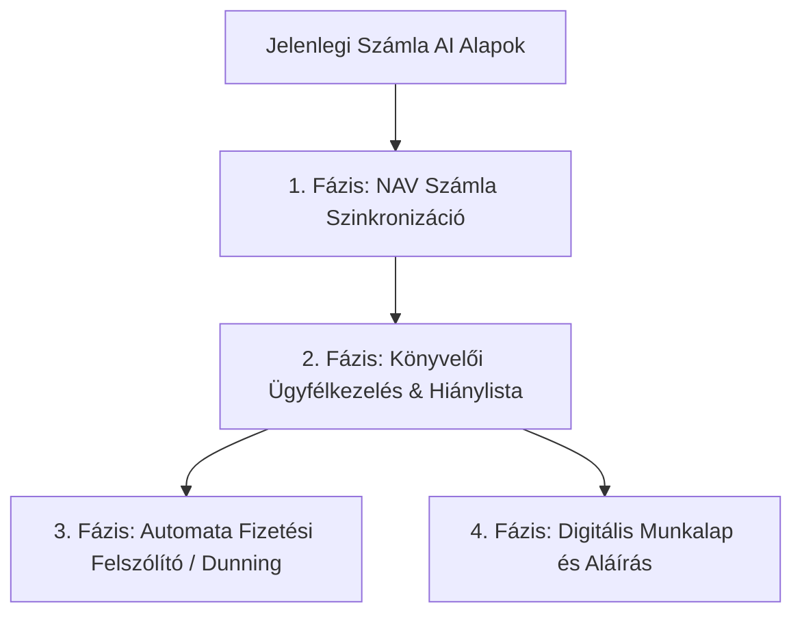

# 🛠️ Rendszer Átvilágítás & SaaS Bővítési Terv (Számla AI Ökoszisztéma)

Ez a dokumentum a **Számla AI** (`szamlazo-app`) kódbázisának alapos forráskódszintű elemzését, valamint a meglévő architektúrára közvetlenül ráépíthető rokon SaaS termékek és modulok megvalósítási tervét tartalmazza.

---

## 🔍 1. A Jelenlegi Projekt Képességei és Architektúrája

A kódbázis átvilágítása alapján a rendszer már most rendelkezik a modern magyar KKV szoftverek legkritikusabb építőelemeivel:

* **Backend:** Hono + TypeScript, moduláris routerekkel (`/api/parse`, `/api/invoices`, `/api/partners`, `/api/export`, `/api/szamlazz`).
* **Frontend:** Astro + DaisyUI + Tailwind + Vanilla TS (Dashboard, Split View szerkesztő, előnézetek, billentyűzet-navigáció).
* **Adatbázis & ORM:** PostgreSQL 16 + Drizzle ORM (`users`, `invoices`, `audit_logs`, `payments`).
* **AI & OCR Motor:** Google Gemini API (`gemini-3.5-flash-lite` / `gemini-2.5-flash`) többoldalas és PDF számlafeldolgozással, SSE streaminggel és Zod séma validációval.
* **Könyvelési Export:** Teljes körű **RLB-60** és CSV formázó motor ([`export-formatter.ts`](file:///d:/github/szamlazo-app/backend/src/services/export-formatter.ts)).
* **Számlázási Integráció:** Közvetlen számlakibocsátás Számlázz.hu Agent API-n keresztül AES-256-GCM titkosított kulcsokkal ([`szamlazz-integration.ts`](file:///d:/github/szamlazo-app/backend/src/szamlazz-integration.ts)).
* **Előkészített adatbázis mezők:** A `users` táblában már szerepel: `navTechnicalUser`, `navTechnicalPassword`, `navSignKey`, `navExchangeKey`, `companyName`, `companyTaxNumber`!
* **UX Extrák:** Hangalapú diktálás ([`voice.ts`](file:///d:/github/szamlazo-app/frontend/src/scripts/voice.ts)), okos partner memória ([`partner-suggest.ts`](file:///d:/github/szamlazo-app/frontend/src/scripts/partner-suggest.ts)).
* **Erőforráslábnyom jelenleg:** ~350 MB RAM (a teljes backend + frontend + DB idle állapotban), azaz a 8 GB VPS kapacitásának alig **4-5%-át** használja!

---

## 💡 2. Milyen Hasonló SaaS Termékeket Lehet Ebbe Beépíteni?

A jelenlegi kódbázis adottságaira építve három kiemelkedően magas üzleti potenciálú modul/projekt integrálható közvetlenül:

```
┌────────────────────────────────────────────────────────────────────────┐
│                        SZÁMLA AI KÖZPONTI MAG                          │
│     (PostgreSQL + Hono API + Astro UI + Gemini AI + S3 Tároló)         │
└───────┬────────────────────────┬───────────────────────┬───────────────┘
        │                        │                       │
        ▼                        ▼                       ▼
┌──────────────────┐   ┌───────────────────┐   ┌──────────────────┐
│ A MODUL:         │   │ B MODUL:          │   │ C MODUL:         │
│ Könyvelői NAV &  │   │ Kintlévőség-      │   │ Digitális        │
│ Bizonylat HUB    │   │ kezelő & Dunning  │   │ Munkalap (Field) │
│ (White-label)    │   │ (Fizetési Bot)    │   │ (Szakembereknek) │
└──────────────────┘   └───────────────────┘   └──────────────────┘
```

---

### 🏛️ A. Modul: Könyvelői NAV & Dokumentum Ingestion HUB ("KönyvelőBox")
> **A jelenlegi projekt legtermészetesebb és legnagyobb szinergiájú bővítése.**

* **Miért illik a kódhoz?** A meglévő RLB-60 exportáló, a Gemini számla-OCR, a partner memória és a már létező NAV technikai felhasználó mezők 80%-ban kész vannak hozzá.
* **Mit csinál az új funkció?**
  1. **Multi-Cég / Ügyfélkapu:** A könyvelő belépve látja az összes ügyfélcégét egy lenyíló menüben (`companies` tábla).
  2. **NAV Online Számla 3.0 API szinkronizáció:** A technikai felhasználó adataival automatikusan letölti az ügyfél összes bejövő (költség) és kimenő számláját XML-ben.
  3. **Intelligens Hiánylista (Reconciliation):** Összefésüli a NAV tételeket a felhasználó által feltöltött PDF/fotó bizonylatokkal:
     * *Zöld:* A számla szerepel a NAV-ban ÉS megvan a fizikai PDF/számlakép is.
     * *Sárga/Piros:* A számla ott van a NAV-ban, de nincs hozzá feltöltve a bizonylat! Egy kattintással értesítő küldhető az ügyfélnek.
  4. **Kész Könyvelési Feladás:** A könyvelő nem kézzel rögzít, hanem egy kattintással letölti a havi RLB-60 vagy Novitax importfájlt.
* **Erőforrásigény:** +150 MB RAM (XML parser worker napi 1 szinkronnal).

---

### ⏰ B. Modul: Kintlévőség-kezelő & Automata Fizetési Felszólító ("SzámlaŐr")
> **Közvetlen pénzt hozó funkció a vállalkozónak (Hard ROI).**

* **Miért illik a kódhoz?** A rendszer már ismeri a számlák fizetési határidejét (`fizetesi_hatarido`), bruttó összegét (`vegosszeg_brutto`), vevő adatait és emailjét (`vevo_email`), valamint közvetlen kapcsolata van a Számlázz.hu-val.
* **Mit csinál az új funkció?**
  1. **Számla fizetettségi státusz kezelése:** `pending` | `paid` | `overdue`.
  2. **Automatikus többlépcsős felszólítás (BullMQ cron):**
     * *-2 nap:* Figyelmeztető email / SMS.
     * *Lejárat napja:* Értesítő banki azonnali QR-kóddal / fizetési linkkel.
     * *+8 nap:* Hivatalos felszólítás a Ptk. szerinti **késedelmi kamat** és a törvényi **40 EUR (~16.000 Ft) behajtási költségátalány** automatikus kiszámításával és ráterhelésével.
     * *+30 nap:* Egykattintásos Fizetési Meghagyás (FMH) / ügyvédi adatcsomag export.
* **Erőforrásigény:** +50 MB RAM (napi 1 cron job + e-mail/SMS küldés).

---

### 🛠️ C. Modul: Digitális Munkalap & Helyszíni Gyorsajánlat ("MesterLap")
> **A meglévő mobil számlakészítő és diktáló funkciók vertikális kiterjesztése szakembereknek.**

* **Miért illik a kódhoz?** A projekt már tartalmazza a mobilbarát kamerás feltöltést, a hangalapú diktálást (`voice.ts`), a partnerkeresőt (`partner-suggest.ts`) és a Számlázz.hu közvetlen számlagenerálást (`szamlazz-integration.ts`).
* **Mit csinál az új funkció?**
  1. **Munkalap Nézet:** Új menüpont a Dashboardon: "Munkalapok".
  2. **Helyszíni kitöltés:** Szaki bediktálja mobilon hanggal a munkát, feltölti az előtte/utána fotókat (amik a meglévő MinIO/S3-ba mennek).
  3. **Digitális Aláírás:** A megrendelő az érintőképernyőn ujjal aláírja a munkalapot (HTML5 Canvas modul).
  4. **Azonnali Számla / Díjbekérő:** A munkalap lezárásakor egy gombnyomásra kiállítja a számlát a meglévő Számlázz.hu motoron keresztül.
  5. **Éves Szerviz Emlékeztető:** 11 hónap múlva automata emlékeztető a vevőnek klímatisztításra / kazánvizsgálatra.
* **Erőforrásigény:** +50 MB RAM.

---

## 📐 3. Javasolt Megvalósítási Terv (Fázisok)

Ha a projektet bővítjük, az alábbi sorrendben a legkönnyebb és legbiztonságosabb haladni:



### 1. Fázis: NAV Online Számla 3.0 API Bekötése (Alapkő)
* **Feladat:** A `schema.ts`-ben már definiált NAV kulcsok aktiválása.
* **Funkció:** Egy gomb a felületen: *"Szinkronizálás a NAV-val"*. A backend a NAV hivatalos REST API-ján lekéri az elmúlt 30 nap bejövő és kimenő számláit.
* **Eredmény:** Azonnal megjelennek a beszállítói számlák anélkül, hogy a felhasználónak be kellene őket fotóznia!

### 2. Fázis: Könyvelői Hiánylista & Dokumentumpárosítás
* **Feladat:** A NAV-ból érkező XML tételek és a felhasználó által feltöltött PDF-ek párosítása számlaszám és adószám alapján.
* **Funkció:** Vizuális jelzés a Dashboardon (pl. piros badge a számlán: *"Nincs csatolva PDF bizonylat"*).
* **Eredmény:** A könyvelőnek felbecsülhetetlen értékű automatizmus a havi záráshoz.

### 3. Fázis: Kintlévőség & Fizetési Emlékeztető (Dunning)
* **Feladat:** Fizetési határidők figyelése és értesítési sablonok (SMS / Email) kiküldése fokozatos szigorúsággal.

---

## 🗄️ 4. Érintett Rendszerösszetevők és Változtatások Tervezete

### Backend Modulok

#### [MODIFY] [`backend/src/db/schema.ts`](file:///d:/github/szamlazo-app/backend/src/db/schema.ts)
* Új `companies` tábla (több cég kezelése könyvelőknek).
* Új mezők az `invoices` táblában:
  * `paymentStatus`: `'pending' | 'paid' | 'overdue'`
  * `navTransactionId`: NAV szinkron azonosító
  * `hasAttachment`: szerepel-e csatolt eredeti bizonylat
  * `reminderCount`: kiküldött felszólítások száma

#### [NEW] `backend/src/services/nav.ts`
* NAV Online Számla 3.0 kliens: SHA3-512 aláírás-generálás, `queryInvoiceData`, `queryInvoiceDigest` hívások lebonyolítása.

#### [NEW] `backend/src/routes/nav.ts`
* `/api/nav/sync`: Adott időszaki számlák lehívása és adatbázisba mentése.
* `/api/nav/test-connection`: Technikai felhasználó érvényességének tesztelése.

#### [NEW] `backend/src/services/dunning.ts`
* Késedelmi kamat kalkulátor (jegybanki alapkamat + törvényi felár), 40 EUR átalány hozzáadása, emlékeztető e-mail generálás.

### Frontend Modulok

#### [MODIFY] [`frontend/src/components/Dashboard.astro`](file:///d:/github/szamlazo-app/frontend/src/components/Dashboard.astro)
* NAV Szinkronizáció gomb elhelyezése az eszköztárban.
* Hiánylista szűrő kapcsoló: *"Csak a bizonylat nélküli NAV számlák mutatása"*.
* Fizetettségi státusz címkék (Zöld: Fizetve, Sárga: Határidőn belül, Piros: Lejárt).

#### [NEW] `frontend/src/components/modals/NavSyncModal.astro`
* Dátumtartomány kiválasztása és élő folyamatjelző a NAV számlák letöltésekor.

#### [MODIFY] [`frontend/src/components/modals/SplitViewModal.astro`](file:///d:/github/szamlazo-app/frontend/src/components/modals/SplitViewModal.astro)
* Munkalap / Fizetési emlékeztető opciók beépítése a szerkesztő jobb oldali akciósávjába.

---

## ❓ 5. Döntési Pontok a Felhasználó Számára (User Review Required)

> [!IMPORTANT]
> Mielőtt bármilyen forráskód módosításba vagy kódírásba kezdenénk, válaszd ki a számodra legvonzóbb fókuszt:

1. **Irányultság kiválasztása:**
   * **A) Könyvelői NAV & Hiánylista HUB:** Kifejezetten könyvelőknek és cégeknek, akik a bejövő számlák letöltését és könyvelési feladását akarják automatizálni. *(Erősen ajánlott, azonnali szinergia!)*
   * **B) Kintlévőség-kezelő & Fizetési Bot:** Minden számlázó cégnek, akik a nem fizető partnerekre akarnak automatikus felszólításokat küldeni.
   * **C) MesterMunkalap:** Szervizeknek és terepen dolgozóknak (klímás, villanyszerelő), digitális aláírással és helyszíni számlázással.
2. **NAV API környezet:**
   * Rendelkezel-e NAV Online Számla tesztkörnyezeti (NAV Teszt) technikai felhasználóval a fejlesztés és tesztelés során, vagy először a mock adatokkal építsük ki a szinkronizációt?

---

## ✅ 6. Verifikációs Terv (Hogyan fogjuk ellenőrizni?)

1. **NAV API Szinkronizáció Tesztelése:**
   * Egységtesztek a NAV XML parserre és az aláírás-kalkulációra Vitesttel (`backend/vitest.config.ts`).
   * Valós vagy tesztkörnyezeti lekérdezés futtatása és válasz-adatbázisba írás ellenőrzése.
2. **Hiánylista Logika:**
   * Tesztesetek olyan számlákra, ahol van NAV rekord, de nincs kép -> UI figyelmeztetés ellenőrzése.
3. **Erőforrás-ellenőrzés:**
   * Memóriahasználat mérése terhelés alatt (Docker stats), garantálva, hogy a Node backend < 300 MB-on marad.
